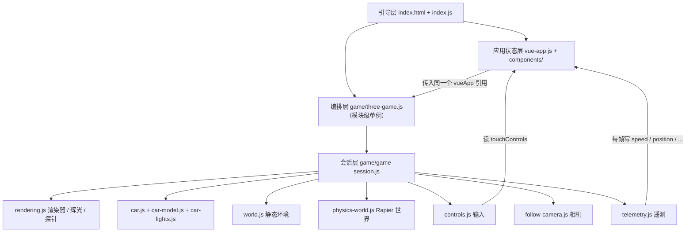

# Apex Cockpit · 车载座舱 HMI / 智驾可视化

> 基于 **Three.js 0.185 + Rapier 0.20** 的座舱驾驶 Demo，正在二次开发为面向 **座舱工程师（3D 可视化）** 岗位的作品集项目。
> 当前状态：**基线梳理完成，二次开发进行中**（本仓库尚未包含仪表盘 / ADAS 可视化功能，见下方"路线图"）。
>
> [English baseline README](README.en.md)（上游英文原版，保留作移植记录）


---

## 一、这个项目是什么

**现状（已在仓库中实现）**：一个可在浏览器直接驾驶的 3D 座舱 Demo —— 关节式车辆物理（悬架 / 转向 / 车轮自转都是真实约束）、座舱第一人称视角（方向盘转动、踏板踩下、挡杆摆动）、选择性辉光后处理、实时立方体反射探针、动态车灯（前灯投影）、遥测 HUD（车速 / 位置 / 朝向 / 碰撞 / 撞箱 / 圈速 / 最高速）与 FPS 监控。

**目标（计划新增，尚未实现）**：把渲染管线与真实物理数据接到座舱 HMI 与智驾可视化上 —— 数字仪表、车辆状态数据层、智驾目标框 / 车道线 / 规划轨迹、性能监控面板，并逐项给出可量化的优化指标。

**这不是什么**：不是自动驾驶算法项目，不含感知 / 规划算法实现；智驾部分做的是**数据表达与可视化**（真值 + 合成噪声的感知层），数据源可插拔。

---

## 二、快速开始

```bash
# 任意静态服务器均可；package.json 里有 5 个脚本，其中 start / serve / dev 是同一个 Python 服务器
python3 -m http.server 8080     # 或 npm start / npm run serve-node / npm run serve-php
```

然后打开 <http://localhost:8080>。

| 前置条件 | 说明 |
|---|---|
| 现代浏览器 | 需要 import map 支持：Chrome 89+ / Firefox 108+ / Safari 16.4+ |
| **必须经 HTTP 访问** | ES Module + import map 在 `file://` 下会被 CORS 拒绝 |
| **首次加载需联网** | Three.js / Rapier / Vue / Draco 解码器全部从 CDN 拉取 |

> ⚠️ 已知文档不一致（本次已修正）：上游 README 写的是 `8000` 端口，`package.json` 里实际是 `8080`。

### 操作方式

| 平台 | 操作 |
|---|---|
| 桌面 | `W/A/S/D` 或方向键驾驶 · `空格` 跳跃（长按持续上升）· `B` 刹车 · `C` 在跟随视角 / 座舱视角间切换 · `鼠标拖拽` 环绕相机 · `Enter` 重置 · `F12` 或 `` ` `` 开关调试面板 |
| 移动端 | 虚拟摇杆驾驶 · 🚗 刹车 · 🚀 跳跃 · 📷 切换视角 · 🔄 重置；桌面按键提示自动隐藏 |

---

## 三、技术栈

| 层 | 技术 | 版本 / 来源 | 证据 |
|---|---|---|---|
| 渲染 | Three.js | **0.185.1**（jsDelivr，精确锁定） | `index.html:13` |
| 后处理 | three/addons（EffectComposer / UnrealBloom / FXAA / Output） | 同版本 | `game/rendering.js:3-8` |
| 物理 | Rapier3D compat（WASM） | **0.20.0**（jsDelivr `+esm`） | `index.html:15` |
| UI | Vue 3 全局构建 | unpkg `vue.global.js`，**未锁定版本** | `index.html:19` |
| 模型 | glTF 2.0 + Draco | 解码器走 CDN | `game/car-model.js:7-8` |
| 模块 | 原生 ES Module + **import map** | **零构建、零 `node_modules`** | `index.html:10-18` |

**源码规模**：25 个源文件 / **3213 行** —— 19 个 JS（2621 行）+ 5 个 CSS（539 行）+ 1 个 HTML（53 行），另加 `package.json`。

**3D 资产**：`game/models/car.glb` = 90 KB，33 mesh / 38 node / **10,398 三角形** / 1 个材质 + 1 张 PNG 贴图，Draco 压缩，**0 动画、0 骨骼**（所有动效都是程序化 + 物理驱动）。

---

## 四、项目结构

```
apex-cockpit/
├── index.html              53 行   import map + Vue 模板宿主 + <canvas>
├── index.js                16 行   唯一入口：DOMContentLoaded → Vue → 游戏
├── vue-app.js             159 行   Vue 根实例（同时充当全局状态容器）
├── game/                 1933 行   Three.js + Rapier 全部逻辑（13 个模块）
│   ├── three-game.js      105      组合根：单例装配 + 帧循环 + 对外 4 个命令
│   ├── game-session.js    105      "一局" = 场景 + 物理世界 + 车 + 环境 + 每帧编排
│   ├── rendering.js       210      Renderer / 选择性辉光 / 反射探针
│   ├── follow-camera.js   128      跟随相机 + 座舱相机（共用一台 PerspectiveCamera）
│   ├── car.js             402      整车装配：底盘 / 悬架 / 转向 / 车轮关节链
│   ├── car-model.js       283      GLB 加载、按节点名拆件、几何烘焙合并
│   ├── car-lights.js       63      车灯自发光 + 前后 SpotLight
│   ├── world.js           252      静态场景（跑道 / 墙 / 塔 / 桥）+ 5 个可撞箱
│   ├── physics-world.js    79      Rapier world / 定步长累加器 / 碰撞分组
│   ├── controls.js        138      键盘 + 触摸 → 关节电机指令
│   ├── telemetry.js       126      遥测、碰撞与撞箱判定、20 Hz HUD
│   ├── fps-meter.js        28      500 ms 窗口平均 FPS
│   ├── color.js            14      Babylon 色彩语义（sRGB）兼容
│   └── models/car.glb      90 KB   手作低多边形 Ford Anglia（Draco）
├── components/            513 行   4 个 Vue 组件（info-panel / desktop-controls / mobile-controls / fps-counter）
├── css/                   539 行   5 个样式表
├── docs/superpowers/specs/         代码库分析报告 + 迭代规划（见文末文档索引）
├── .trellis/                       开发工作流、规范、任务与开发日志
└── THIRD_PARTY_NOTICES.md          第三方代码 / 库 / 资产的分项声明
```

> 📌 上游 README 的结构图里列了 `game/wheel-visuals.js`，**该文件在仓库中并不存在**（车轮视觉由 `car-model.js` 拆件 + `car.js` 装配完成）。此处已修正。

---

## 五、架构梳理

### 5.1 分层与依赖方向



**模块层依赖无环**：`vue-app.js` 单向 import `three-game.js`（调用 reset / toggle），而 `three-game.js` **不** import `vue-app.js`，只在运行时通过参数持有 `vueApp` 引用 —— 所以模块层单向、运行时双向耦合。

### 5.2 模块职责与生命周期

| 模块 | 公共 API | 生命周期 |
|---|---|---|
| `three-game.js` | `initializeGame` / `resetGame` / `resetBoxes` / `toggleView` | **跨会话单例**（renderer / composer / timer / fpsMeter） |
| `game-session.js` | `GameSession.create / update / resize / dispose` | 每次重置重建 |
| `rendering.js` | `GLOW_LAYER` / `createRenderer` / `requestShadowUpdate` / `GlowComposer` / `ReflectionProbe` | renderer + composer 跨会话；探针随会话 |
| `physics-world.js` | `initPhysicsEngine` / `createPhysicsWorld` / `PhysicsStepper` / `syncMeshWithBody` / `COLLISION_GROUPS` | WASM 单次初始化；world 随会话 |
| `car.js` | `Car` / `createCar` | 随会话（几何来自共享缓存） |
| `car-model.js` | `loadCarModel` | **进程级 Promise 缓存** |
| `world.js` | `KnockableBox` / `createEnvironment` | 随会话 |
| `controls.js` / `telemetry.js` / `follow-camera.js` | 各自类 | 随会话（监听器随 `dispose` 摘除） |

### 5.3 核心调用链

**每帧主链**（`renderFrame`，`game/three-game.js:85`）：

```
timer.update()
 → requestShadowUpdate(renderer)                渲染本帧唯一一次阴影贴图
 → session.update(dt)                           game/game-session.js:54
     ├ controls.update()                         controls.js:74 → 电机指令
     ├ car.updateVisuals(...)                    座舱平滑（方向盘 / 踏板 / 挡杆）
     ├ stepper.step(dt)                          物理定步长 1/120，最多 8 子步
     ├ car.syncMeshes() + environment.syncMeshes()
     ├ followCamera.update()                     跟随或座舱视角
     ├ telemetry.update()                        判定 + 20 Hz 写 HUD
     └ reflectionProbe.update()                  渲染立方体贴图的 1 个面
 → glowComposer.render()                        辉光 pass + 合成 + FXAA
 → fpsMeter.tick()                              每 500 ms 更新 FPS
```

**输入链（键盘）**：`window keydown` → `CarControls.handleKey`（`controls.js:53`）→ `pressed[action]=true` → 下一帧 `combineInputs()`（`:100`，键盘 ∪ 触摸）→ `updateSteering/updateSpeed` → `car.setBrake / setMotorSpeed / setSteeringAngle` → Rapier 关节电机 → `world.step()` → `syncMeshWithBody` 写回网格。

**输入链（触摸）**：`touchmove` → 改 `touchControls` → **deep watcher** → `$emit('update-touch-controls')` → `vue-app.onTouchControlsUpdate` → 下一帧被 `combineInputs` 读取。注意这条链路**必须穿过 Vue 响应式系统**才能到达游戏逻辑。

**重置链**：`Enter` → `vueApp.resetGame()`（清 10 个响应式字段）→ `three-game.resetGame`：停帧 → `session.dispose()`（监听器 / render target / 场景资源 / `world.free()`）→ 重建会话（场景 + 物理世界 + 车 + 环境，**GLB 不重新下载**）→ 重新绑定 composer → 重新挂帧循环。

### 5.4 状态管理现状（最需要重构的一点）

**没有 Pinia / Vuex，没有事件总线，没有 Store 抽象** —— `vueApp` 同时扮演"UI 视图模型"和"游戏状态总线"两个角色：`Telemetry` 每帧直写 `vueApp.speed / position.x|y|z / rotation / maxSpeed`（`telemetry.js:63-68`），`CarControls` 读 `vueApp.touchControls`（`controls.js:101`）甚至直接调 `vueApp.resetGame()`（`controls.js:56`）。

后果：游戏逻辑无法脱离 Vue 单测、无法复用，且写入频率被响应式系统放大。**路线图中第一件事就是在游戏层与 UI 层之间插入显式的单向数据流。**

### 5.5 渲染机制

- **帧循环不是裸 `requestAnimationFrame`**：用 `renderer.setAnimationLoop(renderFrame)`（`three-game.js:32`），重置时先 `setAnimationLoop(null)` 再重建。全库 `requestAnimationFrame` 零匹配。
- **一帧里场景被渲染约 3 次**：辉光 pass（全场景 + 非辉光网格换成黑色材质的"黑罩"技巧）+ 最终 pass（全分辨率）+ 反射探针的 1 个立方体面。另有 4 个全屏后处理 pass。
- **选择性辉光没有用 `SelectiveBloomPass`**，而是"黑材质罩 + 黑背景 → 0.25× 分辨率 bloom → 自定义 `mixPass` 加法合成"（`rendering.js:113-134`），非辉光网格列表按场景缓存一次。
- **阴影**：`shadowMap.autoUpdate = false`，每帧开头置一次 `needsUpdate`，于是每帧只重建一次（而不是每个 pass 一次）。
- **光照**：1 个 `HemisphereLight(0.7)` + 2 个 `SpotLight`（前灯 180 / range 60 / 投影 1024²；尾灯 26 / range 22 / 不投影）。
- **材质**：车身 PBR（`metalness 0.85 / roughness 0.25` + 立方体探针 envMap），环境用 `MeshPhongMaterial`，车窗是独立半透明 `depthWrite:false`。
- **色彩**：`babylonColor()` 把上游的 RGB 按 sRGB 解释，末端由 `OutputPass` 收口色彩管理。
- **模型动画**：无 `AnimationMixer` / 骨骼 / morph，全部程序化（物理位姿直拷 + 一阶指数平滑 + 逐轴阻尼相机）。

---

## 六、性能基线（实测，可作为优化前对照）

| 指标 | 实测值 | 来源 |
|---|---|---|
| 首屏载荷 | **≈ 4.48 MB raw / ≈ 1.52 MB gzip** | 逐文件下载实测（含 Draco 解码器） |
| └ Rapier `+esm` | **2,855,554 B**（1.97 MB wasm 被 **base64 内联**进 JS，+33% 膨胀） | jsDelivr 产物 |
| └ Three.js 全量 | 650,153 B（未 tree-shaking） | jsDelivr |
| └ Vue 全局构建 | 601,662 B —— **dev 构建**（prod 版仅 170,605 B） | unpkg |
| └ Draco 解码器 wasm | 285,747 B（88,115 B gzip） | jsDelivr |
| └ car.glb | 90,048 B（已 Draco） | 仓库内 |
| 场景 Mesh 数 | **38**（环境 25 + 车辆 13） | 逐行清点 |
| 每帧场景遍历 | **约 3 次** + 4 个全屏后处理 pass | 源码路径 |
| 阴影贴图 | 1024²，每帧一次 | `rendering.js:56,64` |
| 辉光分辨率 | 全屏 × 0.25 | `rendering.js:19` |
| 反射探针 | 128² cube，首帧 6 面，之后每帧 1 面 | `rendering.js:167-190` |
| 物理 | 定步长 120 Hz，最多 8 子步，solver 16 次 + 车身额外 4 次 | `physics-world.js:5-7`、`car.js:14` |
| 设备像素比 | 上限 **1**（按 CSS 像素渲染） | `rendering.js:14` |

---

## 七、已知问题（按严重度，全部有源码位置）

> 完整清单（22 条分级发现）与逐条证据见 [代码库分析报告](docs/superpowers/specs/2026-10-15-codebase-analysis.md)。

### P0 · 演示现场就会翻车

| # | 问题 | 位置 |
|---|---|---|
| 1 | **渲染循环无错误边界**：任一异常抛在 `renderFrame` 内，three 的 `WebGLAnimation` 不会再排下一帧 → **画面永久冻结**，只有一条 console 错误 | `three-game.js:85-91` |
| 2 | **加载失败被永久缓存**：模块级 Promise 把 reject 也缓存，一次 CDN 抖动后每次重置都立即失败，**无重试路径** | `physics-world.js:24-28`、`car-model.js:41-46` |
| 3 | **WebGL 上下文丢失零处理**：全库 grep `webglcontextlost` 零命中 —— 车机上"闪退 / 黑屏"的典型成因 | 全库 |
| 4 | **重置无重入保护**：连按 `Enter` 会让两个异步流程交错，落败的会话（含 Rapier world）永不释放 | `three-game.js:44-57` |
| 5 | **触摸无 `touchcancel`**：系统手势打断后 `touchend` 不触发 → 刹车 / 跳跃**永久卡在按下状态**，跳跃的 50 ms 定时器也不会被清 | `mobile-controls.js:120-122,150-171` |
| 6 | **HUD 单位错误**：物理速度被直接标成 `km/h`；`UNITS_PER_METER = 8` 定义了却从未参与换算 | `info-panel.js:16,72`、`physics-world.js:8` |

### P1 · 手感、性能与健壮性

| # | 问题 | 位置 |
|---|---|---|
| 7 | **控制层与相机按"每帧"步进，不接收 `dt`**：只有物理吃 delta → **刷新率一变，油门与转向手感就变**（144 Hz 与 60 Hz 差约 2.4 倍） | `controls.js:5-8`、`follow-camera.js:13`、`game-session.js:57` |
| 8 | `new THREE.Timer()` 从未调用 `connect(document)` → 页面可见性保护**未生效**，隐藏标签页回来后首帧 delta 等于整个隐藏时长 | `three-game.js:15`（已核对 three 0.185.1 源码） |
| 9 | 辉光 pass 用"全场景 + 黑罩"实现 → 每帧多一次全场景遍历；改用 `camera.layers` 只渲染发光对象可省掉 | `rendering.js:113-134,198` |
| 10 | 阴影贴图每帧重建（`autoUpdate=false` 的收益被抵消） | `three-game.js:87`、`rendering.js:56,64` |
| 11 | 用**共享材质**的 `material.visible` 去隐藏单个网格（该材质被 **10 个**网格共用：车身 / 方向盘 / 3 个座舱部件 / 转向柱 / 4 个车轮）→ 结果"恰好正确"，但把实现细节变成了隐式契约 | `rendering.js:167,174`、`car.js:166,211,215-217,222,308` |
| 12 | 移动端输入穿过 Vue 响应式（每次 `touchmove` 一圈 deep watch → emit），且跳跃另开 50 ms `setInterval` 重复 emit | `mobile-controls.js:33-40,120-127,150-161` |
| 13 | 物理**永不休眠**（车身与所有轮组 `setCanSleep(false)`）+ 16 次 solver → 峰值约 960 次 `world.step()`/秒，直接挤占渲染预算 | `car.js:259,353,361` |
| 14 | 18 个静态盒体各自 `new BoxGeometry`，无实例化 / 合批；800×800 场地几乎全在视锥内，剔除收益≈0 | `world.js:236` |
| 15 | 4 处 window / document 监听**未移除**（`vue-app.js` 4 个、`mobile-controls.js` 6 个）→ 复用或热替换时累积泄漏 | `vue-app.js:126-131`、`mobile-controls.js:120-127` |
| 16 | `renderer.info` 完全未采集；且其 `autoReset` 默认为 `true`，**一帧多次 `render()` 会清零** —— 做性能面板必须手动 `reset()` | 全库 |
| 17 | 加载全过程无任何 UI 反馈（`RAPIER.init()` 与 GLTF 加载都没有 loading 态 / 失败态） | `physics-world.js:26`、`car-model.js:50` |
| 18 | `resize` 无防抖，而 `EffectComposer.setSize` 会**重建帧缓冲** → 拖拽窗口时每秒几十次重分配 | `three-game.js:33`、`rendering.js:108-111` |

### P2 · 卫生与一致性

| # | 问题 | 位置 |
|---|---|---|
| 19 | 反射探针 `dispose()` 不解除材质的 `envMap` 引用，而该材质被跨会话缓存 → 短暂持有已释放纹理 | `rendering.js:192-194` |
| 20 | 两种时间口径混用：碰撞冷却用**模拟时间**（正确），圈速却用 `Date.now()`（隐藏标签页会照算） | `telemetry.js:94/105` vs `78/84` |
| 21 | 4 套互不知情的 `keydown` 监听，且驾驶键未 `preventDefault` | `controls.js:44`、`follow-camera.js:49`、`desktop-controls.js:45`、`info-panel.js:105` |
| 22 | 每次重置重建整个环境（18+ 几何体 + collider），叠加 P0-4 时卡顿明显 | `world.js:112` |

### 已有的优化（值得保留并写进简历）

阴影按需更新 · 辉光 0.25× 分辨率 · `MSAA=0` + FXAA 规避集显的 half-float 多重采样 · 反射探针每帧只刷新 1 个面 · 变暗网格列表按场景缓存 · scratch 向量与输入对象复用（零每帧分配）· HUD 20 Hz 节流 · 物理定步长 + 子步上限防死亡螺旋 · GLB 几何/材质跨会话复用（`userData.shared`）· `RAPIER.init()` 单次缓存。

---

## 八、路线图（三周 / 三个迭代）

| 迭代 | 目标 | 交付物 |
|---|---|---|
| **1** | 可靠运行的 TS 工程 | Vite + TypeScript + React 19 迁移 · 渲染循环错误边界 · WebGL 上下文丢失恢复 · 加载重试与可见错误态 · 包体首刀 |
| **2** | 有数据的座舱 | `VehicleState` + 状态总线（替换 `vueApp` 直写）· 控制/相机/座舱 delta 化 · 数字仪表 · 高速公路舞台（确定性自车轨迹） |
| **3** | 有叙事的智驾可视化 | ADAS 图层（目标框 / 车道线 / 规划轨迹，`THREE.Layers` 与辉光、反射探针隔离）· 真值 vs 噪声感知可切换 · 自研性能面板 · 前端规范回填 · 中英文档与在线演示 |

**量化目标（优化前 → 目标）**：

| 指标 | 现状 | 目标 |
|---|---|---|
| 首屏 gzip | ≈ 1.52 MB | **≤ 450 KB**（Rapier 懒加载 + wasm 自托管，去掉 base64 膨胀） |
| 总包 gzip | ≈ 1.52 MB | ≤ 0.9 MB |
| draw call / 帧 | ≈ 120–150（推算） | ≤ 80 |
| 场景遍历 / 帧 | 3 次 | ≤ 3 次（阴影节流 + 探针空闲暂停） |
| WebGL 上下文丢失 | 无处理 | ≤ 60 s 内自动恢复 |
| 运行期异常 | 永久冻屏 | 兜底 + 一键恢复 |
| 帧率（CPU 4× 节流） | 未测 | ≥ 30 fps（车机代理基线） |

**明确不做**：真实感知 / 点云算法、后端与云端、Unity / Godot / Cocos 移植、多屏物理联动与语音交互、完整设计系统、车规认证。

完整计划（含每轮的改动文件清单、验收标准、风险与砍单顺序）见 [迭代规划](docs/superpowers/specs/2026-10-15-iteration-plan.md)。

---

## 九、移植说明（Babylon.js → Three.js）

- **手性**：Babylon.js 左手系、Three.js 右手系，场景 X 轴整体镜像以保持布局一致；车仍朝 +Z 行驶，因此 +X 是车的左侧。
- **物理**：Havok 的软 6DoF 约束换成"每个车轮一串关节"—— 转向 `revolute(Y)` → 悬架 `prismatic(Y)` → 车轮自转 `revolute(X)`，沿用原版的刚度与阻尼。
- **电机**：Rapier 的力基电机模型 + 原版最大力，复现相同的加速与制动曲线。
- **碰撞**：车辆部件之间互不碰撞（Rapier 碰撞组的高 16 位成员 / 低 16 位过滤），环境与所有组碰撞。
- **车身碰撞体**：由烘焙后的车身顶点生成**凸包**（并对生成失败显式抛错），惯量按长方体近似显式设入。
- **检测时序**：撞箱与碰撞冷却跑在**模拟物理时间**上，慢帧或隐藏标签页不会造成幽灵命中。
- **重置**：GLB 结果被缓存，重置只重建场景与物理世界，不重新下载模型。
- **色彩**：上游 `StandardMaterial` 未做 gamma 校正，这里把原始 RGB 按 sRGB 解释以复现观感（`game/color.js`）。

---

## 十、开发约定

本仓库使用 **Trellis** 管理工作流：`.trellis/workflow.md`（计划 / 执行 / 收尾三段）、`.trellis/spec/`（分层编码规范）、`.trellis/tasks/`（任务）、`.trellis/workspace/`（开发日志）。规范中前端层目前仍是待填模板，会在迭代 1 按真实代码回填。

文档索引：

| 文档 | 内容 |
|---|---|
| [代码库分析报告](docs/superpowers/specs/2026-10-15-codebase-analysis.md) | L1–L4 全量梳理：技术栈 / 架构 / 调用链 / 渲染机制 / 22 条分级性能与健壮性发现 / 20 道基于真实源码的面试题 |
| [迭代规划](docs/superpowers/specs/2026-10-15-iteration-plan.md) | 三周三个迭代的目标、交付物、改动文件清单、可量化验收标准、风险与砍单顺序 |
| [THIRD_PARTY_NOTICES.md](THIRD_PARTY_NOTICES.md) | 第三方代码 / 库 / 模型的分项声明 |

---

## 十一、许可与署名

本项目源码基于 **MIT License**（见 [LICENSE](LICENSE)）。

- **上游基线**：本仓库是 [manuelhintermayr/three-js-car-example](https://github.com/manuelhintermayr/three-js-car-example)（MIT，作者 Manuel Hintermayr）的二次开发，而上游本身是 [babylon-js-car-example](https://github.com/manuelhintermayr/babylon-js-car-example) 从 Babylon.js + Havok 到 Three.js + Rapier 的移植。Vue 组件与样式表沿用上游。
- **第三方示例代码**：车辆物理与相机控制源自 Babylon.js Playground 公开示例（[#ANV5OM#139](https://www.babylonjs-playground.com/#ANV5OM#139)、[#FMQX86#1](https://playground.babylonjs.com/#FMQX86#1)）；选择性辉光合成源自 Three.js 官方示例 `webgl_postprocessing_unreal_bloom_selective`（MIT）。
- **第三方库**：Three.js（MIT）、Rapier（Apache-2.0）、Vue.js（MIT），均运行时从 CDN 加载。
- **3D 模型**：`game/models/car.glb` 是 Manuel Hintermayr 手作的低多边形 Ford Anglia，**不在代码许可范围内**，按 [THIRD_PARTY_NOTICES.md](THIRD_PARTY_NOTICES.md) 第 4 节的要求单独署名。

详细分项声明见 [THIRD_PARTY_NOTICES.md](THIRD_PARTY_NOTICES.md)。
