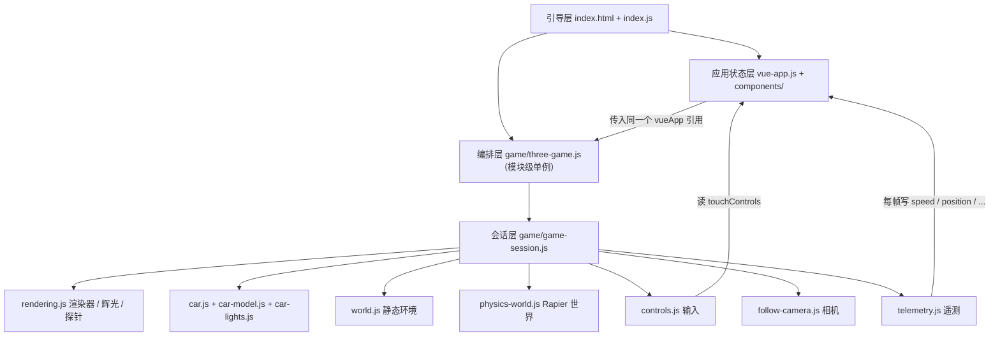

# Apex Cockpit · 车载座舱 HMI / 智驾可视化

> 基于 **Three.js 0.185 + Rapier 0.20** 的座舱驾驶 Demo，正在二次开发为面向 **座舱工程师（3D 可视化）** 岗位的作品集项目。
> 当前状态：**迭代 1 已完成** —— 已从无构建的 Vue 版迁移到 **Vite + TypeScript(strict) + React 19**，行为逐帧等价（601 帧物理状态零差异），运行时加固（错误边界 / 上下文丢失恢复 / 加载重试 / 重置资源不泄漏），首屏 gzip **1,333.9 kB → 72.9 kB**。仪表盘与 ADAS 可视化在迭代 2–3（见"路线图"）。
>
> [English baseline README](README.en.md)（上游英文原版，保留作移植记录）


---

## 一、这个项目是什么

**现状（已在仓库中实现）**：一个可在浏览器直接驾驶的 3D 座舱 Demo —— 关节式车辆物理（悬架 / 转向 / 车轮自转都是真实约束）、座舱第一人称视角（方向盘转动、踏板踩下、挡杆摆动）、选择性辉光后处理、实时立方体反射探针、动态车灯（前灯投影）、遥测 HUD（车速 / 位置 / 朝向 / 碰撞 / 撞箱 / 圈速 / 最高速）与 FPS 监控。

**目标（计划新增，尚未实现）**：把渲染管线与真实物理数据接到座舱 HMI 与智驾可视化上 —— 数字仪表、车辆状态数据层、智驾目标框 / 车道线 / 规划轨迹、性能监控面板，并逐项给出可量化的优化指标。

**这不是什么**：不是自动驾驶算法项目，不含感知 / 规划算法实现；智驾部分做的是**数据表达与可视化**（真值 + 合成噪声的感知层），数据源可插拔。

---

## 二、快速开始

```bash
npm install          # Node >= 22.12
npm run dev          # 开发服务器（Vite，默认 http://localhost:5173）
npm run build        # 产出静态 dist/（可直接用任意静态服务器托管）
npm run preview      # 预览构建产物（http://localhost:8080）
```

打开终端提示的地址即可。`dist/` 是纯静态产物，也可用 `python3 -m http.server 8080 --directory dist` 之类的方式托管。

| 前置条件 | 说明 |
|---|---|
| Node.js | ≥ 22.12（构建与测试） |
| 现代浏览器 | 需要 WebGL2 与 ES2022：Chrome 89+ / Firefox 108+ / Safari 16.4+ |
| **必须经 HTTP 访问** | ES Module 在 `file://` 下会被 CORS 拒绝 |
| **离线可用** | 所有运行期资源（three / Rapier wasm / Draco / GLB）都由构建产出，产物中不含任何 CDN 引用（`grep -rlo "cdn.jsdelivr.net\|unpkg.com" dist/` 为空） |

> ⚠️ 已知文档不一致（已修正）：上游 README 写的是 `8000` 端口，`package.json` 里实际是 `8080`；上游提到的 `game/wheel-visuals.js` 在仓库中并不存在。

### 操作方式

| 平台 | 操作 |
|---|---|
| 桌面 | `W/A/S/D` 或方向键驾驶 · `空格` 跳跃（长按持续上升）· `B` 刹车 · `C` 在跟随视角 / 座舱视角间切换 · `鼠标拖拽` 环绕相机 · `Enter` 重置 · `F12` 或 `` ` `` 开关调试面板 |
| 移动端 | 虚拟摇杆驾驶 · 🚗 刹车 · 🚀 跳跃 · 📷 切换视角 · 🔄 重置；桌面按键提示自动隐藏 |

---

## 三、技术栈

| 层 | 技术 | 版本 / 来源 | 证据 |
|---|---|---|---|
| 渲染 | Three.js | **0.185.1**（jsDelivr，精确锁定） | `index.html:13` |
| 后处理 | three/addons（EffectComposer / UnrealBloom / FXAA / Output） | 同版本 | `game/rendering.js:3-8` |
| 物理 | Rapier3D compat（WASM） | **0.20.0**（jsDelivr `+esm`） | `index.html:15` |
| UI | Vue 3 全局构建 | unpkg `vue.global.js`，**未锁定版本** | `index.html:19` |
| 模型 | glTF 2.0 + Draco | 解码器走 CDN | `game/car-model.js:7-8` |
| 模块 | 原生 ES Module + **import map** | **零构建、零 `node_modules`** | `index.html:10-18` |

**源码规模**：25 个源文件 / **3213 行** —— 19 个 JS（2621 行）+ 5 个 CSS（539 行）+ 1 个 HTML（53 行），另加 `package.json`。

**3D 资产**：`game/models/car.glb` = 90 KB，33 mesh / 38 node / **10,398 三角形** / 1 个材质 + 1 张 PNG 贴图，Draco 压缩，**0 动画、0 骨骼**（所有动效都是程序化 + 物理驱动）。

---

## 四、项目结构

```
apex-cockpit/
├── index.html              53 行   import map + Vue 模板宿主 + <canvas>
├── index.js                16 行   唯一入口：DOMContentLoaded → Vue → 游戏
├── vue-app.js             159 行   Vue 根实例（同时充当全局状态容器）
├── game/                 1933 行   Three.js + Rapier 全部逻辑（13 个模块）
│   ├── three-game.js      105      组合根：单例装配 + 帧循环 + 对外 4 个命令
│   ├── game-session.js    105      "一局" = 场景 + 物理世界 + 车 + 环境 + 每帧编排
│   ├── rendering.js       210      Renderer / 选择性辉光 / 反射探针
│   ├── follow-camera.js   128      跟随相机 + 座舱相机（共用一台 PerspectiveCamera）
│   ├── car.js             402      整车装配：底盘 / 悬架 / 转向 / 车轮关节链
│   ├── car-model.js       283      GLB 加载、按节点名拆件、几何烘焙合并
│   ├── car-lights.js       63      车灯自发光 + 前后 SpotLight
│   ├── world.js           252      静态场景（跑道 / 墙 / 塔 / 桥）+ 5 个可撞箱
│   ├── physics-world.js    79      Rapier world / 定步长累加器 / 碰撞分组
│   ├── controls.js        138      键盘 + 触摸 → 关节电机指令
│   ├── telemetry.js       126      遥测、碰撞与撞箱判定、20 Hz HUD
│   ├── fps-meter.js        28      500 ms 窗口平均 FPS
│   ├── color.js            14      Babylon 色彩语义（sRGB）兼容
│   └── models/car.glb      90 KB   手作低多边形 Ford Anglia（Draco）
├── components/            513 行   4 个 Vue 组件（info-panel / desktop-controls / mobile-controls / fps-counter）
├── css/                   539 行   5 个样式表
├── docs/superpowers/specs/         代码库分析报告 + 迭代规划（见文末文档索引）
├── .trellis/                       开发工作流、规范、任务与开发日志
└── THIRD_PARTY_NOTICES.md          第三方代码 / 库 / 资产的分项声明
```

> 📌 上游 README 的结构图里列了 `game/wheel-visuals.js`，**该文件在仓库中并不存在**（车轮视觉由 `car-model.js` 拆件 + `car.js` 装配完成）。此处已修正。

---

## 五、架构梳理

> 本节描述的是**迁移前的上游基线**（Vue 全局构建 + 无打包 + import map），用于说明"改造前是什么样"。
> 迁移后的结构与对照见 §十二「迭代 1 交付说明」。

### 5.1 分层与依赖方向



**模块层依赖无环**：`vue-app.js` 单向 import `three-game.js`（调用 reset / toggle），而 `three-game.js` **不** import `vue-app.js`，只在运行时通过参数持有 `vueApp` 引用 —— 所以模块层单向、运行时双向耦合。

### 5.2 模块职责与生命周期

| 模块 | 公共 API | 生命周期 |
|---|---|---|
| `three-game.js` | `initializeGame` / `resetGame` / `resetBoxes` / `toggleView` | **跨会话单例**（renderer / composer / timer / fpsMeter） |
| `game-session.js` | `GameSession.create / update / resize / dispose` | 每次重置重建 |
| `rendering.js` | `GLOW_LAYER` / `createRenderer` / `requestShadowUpdate` / `GlowComposer` / `ReflectionProbe` | renderer + composer 跨会话；探针随会话 |
| `physics-world.js` | `initPhysicsEngine` / `createPhysicsWorld` / `PhysicsStepper` / `syncMeshWithBody` / `COLLISION_GROUPS` | WASM 单次初始化；world 随会话 |
| `car.js` | `Car` / `createCar` | 随会话（几何来自共享缓存） |
| `car-model.js` | `loadCarModel` | **进程级 Promise 缓存** |
| `world.js` | `KnockableBox` / `createEnvironment` | 随会话 |
| `controls.js` / `telemetry.js` / `follow-camera.js` | 各自类 | 随会话（监听器随 `dispose` 摘除） |

### 5.3 核心调用链

**每帧主链**（`renderFrame`，`game/three-game.js:85`）：

```
timer.update()
 → requestShadowUpdate(renderer)                渲染本帧唯一一次阴影贴图
 → session.update(dt)                           game/game-session.js:54
     ├ controls.update()                         controls.js:74 → 电机指令
     ├ car.updateVisuals(...)                    座舱平滑（方向盘 / 踏板 / 挡杆）
     ├ stepper.step(dt)                          物理定步长 1/120，最多 8 子步
     ├ car.syncMeshes() + environment.syncMeshes()
     ├ followCamera.update()                     跟随或座舱视角
     ├ telemetry.update()                        判定 + 20 Hz 写 HUD
     └ reflectionProbe.update()                  渲染立方体贴图的 1 个面
 → glowComposer.render()                        辉光 pass + 合成 + FXAA
 → fpsMeter.tick()                              每 500 ms 更新 FPS
```

**输入链（键盘）**：`window keydown` → `CarControls.handleKey`（`controls.js:53`）→ `pressed[action]=true` → 下一帧 `combineInputs()`（`:100`，键盘 ∪ 触摸）→ `updateSteering/updateSpeed` → `car.setBrake / setMotorSpeed / setSteeringAngle` → Rapier 关节电机 → `world.step()` → `syncMeshWithBody` 写回网格。

**输入链（触摸）**：`touchmove` → 改 `touchControls` → **deep watcher** → `$emit('update-touch-controls')` → `vue-app.onTouchControlsUpdate` → 下一帧被 `combineInputs` 读取。注意这条链路**必须穿过 Vue 响应式系统**才能到达游戏逻辑。

**重置链**：`Enter` → `vueApp.resetGame()`（清 10 个响应式字段）→ `three-game.resetGame`：停帧 → `session.dispose()`（监听器 / render target / 场景资源 / `world.free()`）→ 重建会话（场景 + 物理世界 + 车 + 环境，**GLB 不重新下载**）→ 重新绑定 composer → 重新挂帧循环。

### 5.4 状态管理现状（最需要重构的一点）

**没有 Pinia / Vuex，没有事件总线，没有 Store 抽象** —— `vueApp` 同时扮演"UI 视图模型"和"游戏状态总线"两个角色：`Telemetry` 每帧直写 `vueApp.speed / position.x|y|z / rotation / maxSpeed`（`telemetry.js:63-68`），`CarControls` 读 `vueApp.touchControls`（`controls.js:101`）甚至直接调 `vueApp.resetGame()`（`controls.js:56`）。

后果：游戏逻辑无法脱离 Vue 单测、无法复用，且写入频率被响应式系统放大。**路线图中第一件事就是在游戏层与 UI 层之间插入显式的单向数据流。**

### 5.5 渲染机制

- **帧循环不是裸 `requestAnimationFrame`**：用 `renderer.setAnimationLoop(renderFrame)`（`three-game.js:32`），重置时先 `setAnimationLoop(null)` 再重建。全库 `requestAnimationFrame` 零匹配。
- **一帧里场景被渲染约 3 次**：辉光 pass（全场景 + 非辉光网格换成黑色材质的"黑罩"技巧）+ 最终 pass（全分辨率）+ 反射探针的 1 个立方体面。另有 4 个全屏后处理 pass。
- **选择性辉光没有用 `SelectiveBloomPass`**，而是"黑材质罩 + 黑背景 → 0.25× 分辨率 bloom → 自定义 `mixPass` 加法合成"（`rendering.js:113-134`），非辉光网格列表按场景缓存一次。
- **阴影**：`shadowMap.autoUpdate = false`，每帧开头置一次 `needsUpdate`，于是每帧只重建一次（而不是每个 pass 一次）。
- **光照**：1 个 `HemisphereLight(0.7)` + 2 个 `SpotLight`（前灯 180 / range 60 / 投影 1024²；尾灯 26 / range 22 / 不投影）。
- **材质**：车身 PBR（`metalness 0.85 / roughness 0.25` + 立方体探针 envMap），环境用 `MeshPhongMaterial`，车窗是独立半透明 `depthWrite:false`。
- **色彩**：`babylonColor()` 把上游的 RGB 按 sRGB 解释，末端由 `OutputPass` 收口色彩管理。
- **模型动画**：无 `AnimationMixer` / 骨骼 / morph，全部程序化（物理位姿直拷 + 一阶指数平滑 + 逐轴阻尼相机）。

---

## 六、性能基线（实测，可作为优化前对照）

| 指标 | 实测值 | 来源 |
|---|---|---|
| 首屏载荷 | **≈ 4.48 MB raw / ≈ 1.52 MB gzip** | 逐文件下载实测（含 Draco 解码器） |
| └ Rapier `+esm` | **2,855,554 B**（1.97 MB wasm 被 **base64 内联**进 JS，+33% 膨胀） | jsDelivr 产物 |
| └ Three.js 全量 | 650,153 B（未 tree-shaking） | jsDelivr |
| └ Vue 全局构建 | 601,662 B —— **dev 构建**（prod 版仅 170,605 B） | unpkg |
| └ Draco 解码器 wasm | 285,747 B（88,115 B gzip） | jsDelivr |
| └ car.glb | 90,048 B（已 Draco） | 仓库内 |
| 场景 Mesh 数 | **38**（环境 25 + 车辆 13） | 逐行清点 |
| 每帧场景遍历 | **约 3 次** + 4 个全屏后处理 pass | 源码路径 |
| 阴影贴图 | 1024²，每帧一次 | `rendering.js:56,64` |
| 辉光分辨率 | 全屏 × 0.25 | `rendering.js:19` |
| 反射探针 | 128² cube，首帧 6 面，之后每帧 1 面 | `rendering.js:167-190` |
| 物理 | 定步长 120 Hz，最多 8 子步，solver 16 次 + 车身额外 4 次 | `physics-world.js:5-7`、`car.js:14` |
| 设备像素比 | 上限 **1**（按 CSS 像素渲染） | `rendering.js:14` |

---

## 七、已知问题（按严重度，全部有源码位置）

> 完整清单（22 条分级发现）与逐条证据见 [代码库分析报告](docs/superpowers/specs/2026-10-15-codebase-analysis.md)。

### P0 · 演示现场就会翻车

| # | 问题 | 位置 |
|---|---|---|
| 1 | **渲染循环无错误边界**：任一异常抛在 `renderFrame` 内，three 的 `WebGLAnimation` 不会再排下一帧 → **画面永久冻结**，只有一条 console 错误 | `three-game.js:85-91` |
| 2 | **加载失败被永久缓存**：模块级 Promise 把 reject 也缓存，一次 CDN 抖动后每次重置都立即失败，**无重试路径** | `physics-world.js:24-28`、`car-model.js:41-46` |
| 3 | **WebGL 上下文丢失只有底层处理、没有应用层恢复**：three 的 `WebGLRenderer` 自己注册了两个上下文事件（丢帧时 `preventDefault()`，恢复时 `initGLContext()` + 重建内置状态，见 §研究文档），但**应用层没有任何配合** —— composer / 反射探针的 render target 仍绑在旧上下文上，渲染循环也不会停，物理时钟还会继续积分 | 全库（应用层） |
| 4 | **重置无重入保护**：连按 `Enter` 会让两个异步流程交错，落败的会话（含 Rapier world）永不释放 | `three-game.js:44-57` |
| 5 | **触摸无 `touchcancel`**：系统手势打断后 `touchend` 不触发 → 刹车 / 跳跃**永久卡在按下状态**，跳跃的 50 ms 定时器也不会被清 | `mobile-controls.js:120-122,150-171` |
| 6 | **HUD 单位错误**：物理速度被直接标成 `km/h`；`UNITS_PER_METER = 8` 定义了却从未参与换算 | `info-panel.js:16,72`、`physics-world.js:8` |

### P1 · 手感、性能与健壮性

| # | 问题 | 位置 |
|---|---|---|
| 7 | **控制层与相机按"每帧"步进，不接收 `dt`**：只有物理吃 delta → **刷新率一变，油门与转向手感就变**（144 Hz 与 60 Hz 差约 2.4 倍） | `controls.js:5-8`、`follow-camera.js:13`、`game-session.js:57` |
| 8 | `new THREE.Timer()` 从未调用 `connect(document)` → 页面可见性保护**未生效**，隐藏标签页回来后首帧 delta 等于整个隐藏时长 | `three-game.js:15`（已核对 three 0.185.1 源码） |
| 9 | 辉光 pass 用"全场景 + 黑罩"实现 → 每帧多一次全场景遍历；改用 `camera.layers` 只渲染发光对象可省掉 | `rendering.js:113-134,198` |
| 10 | 阴影贴图每帧重建（`autoUpdate=false` 的收益被抵消） | `three-game.js:87`、`rendering.js:56,64` |
| 11 | 用**共享材质**的 `material.visible` 去隐藏单个网格（该材质被 **10 个**网格共用：车身 / 方向盘 / 3 个座舱部件 / 转向柱 / 4 个车轮）→ 结果"恰好正确"，但把实现细节变成了隐式契约 | `rendering.js:167,174`、`car.js:166,211,215-217,222,308` |
| 12 | 移动端输入穿过 Vue 响应式（每次 `touchmove` 一圈 deep watch → emit），且跳跃另开 50 ms `setInterval` 重复 emit | `mobile-controls.js:33-40,120-127,150-161` |
| 13 | 物理**永不休眠**（车身与所有轮组 `setCanSleep(false)`）+ 16 次 solver → 峰值约 960 次 `world.step()`/秒，直接挤占渲染预算 | `car.js:259,353,361` |
| 14 | 18 个静态盒体各自 `new BoxGeometry`，无实例化 / 合批；800×800 场地几乎全在视锥内，剔除收益≈0 | `world.js:236` |
| 15 | 4 处 window / document 监听**未移除**（`vue-app.js` 4 个、`mobile-controls.js` 6 个）→ 复用或热替换时累积泄漏 | `vue-app.js:126-131`、`mobile-controls.js:120-127` |
| 16 | `renderer.info` 完全未采集；且其 `autoReset` 默认为 `true`，**一帧多次 `render()` 会清零** —— 做性能面板必须手动 `reset()` | 全库 |
| 17 | 加载全过程无任何 UI 反馈（`RAPIER.init()` 与 GLTF 加载都没有 loading 态 / 失败态） | `physics-world.js:26`、`car-model.js:50` |
| 18 | `resize` 无防抖，而 `EffectComposer.setSize` 会**重建帧缓冲** → 拖拽窗口时每秒几十次重分配 | `three-game.js:33`、`rendering.js:108-111` |

### P2 · 卫生与一致性

| # | 问题 | 位置 |
|---|---|---|
| 19 | 反射探针 `dispose()` 不解除材质的 `envMap` 引用，而该材质被跨会话缓存 → 短暂持有已释放纹理 | `rendering.js:192-194` |
| 20 | 两种时间口径混用：碰撞冷却用**模拟时间**（正确），圈速却用 `Date.now()`（隐藏标签页会照算） | `telemetry.js:94/105` vs `78/84` |
| 21 | 4 套互不知情的 `keydown` 监听，且驾驶键未 `preventDefault` | `controls.js:44`、`follow-camera.js:49`、`desktop-controls.js:45`、`info-panel.js:105` |
| 22 | 每次重置重建整个环境（18+ 几何体 + collider），叠加 P0-4 时卡顿明显 | `world.js:112` |

### 已有的优化（值得保留并写进简历）

阴影按需更新 · 辉光 0.25× 分辨率 · `MSAA=0` + FXAA 规避集显的 half-float 多重采样 · 反射探针每帧只刷新 1 个面 · 变暗网格列表按场景缓存 · scratch 向量与输入对象复用（零每帧分配）· HUD 20 Hz 节流 · 物理定步长 + 子步上限防死亡螺旋 · GLB 几何/材质跨会话复用（`userData.shared`）· `RAPIER.init()` 单次缓存。

---

## 八、路线图（三周 / 三个迭代）

| 迭代 | 目标 | 交付物 |
|---|---|---|
| **1** | 可靠运行的 TS 工程 | Vite + TypeScript + React 19 迁移 · 渲染循环错误边界 · WebGL 上下文丢失恢复 · 加载重试与可见错误态 · 包体首刀 |
| **2** | 有数据的座舱 | `VehicleState` + 状态总线（替换 `vueApp` 直写）· 控制/相机/座舱 delta 化 · 数字仪表 · 高速公路舞台（确定性自车轨迹） |
| **3** | 有叙事的智驾可视化 | ADAS 图层（目标框 / 车道线 / 规划轨迹，`THREE.Layers` 与辉光、反射探针隔离）· 真值 vs 噪声感知可切换 · 自研性能面板 · 前端规范回填 · 中英文档与在线演示 |

**量化目标（现状 → 迭代 1 实测 → 目标）**：

| 指标 | 现状 | 迭代 1 实测 | 目标 | 判定 |
|---|---|---|---|---|
| 首屏 gzip | ≈ 1.52 MB | **72.9 kB**（html + css + entry chunk） | ≤ 450 KB | ✅ 超标达成（18.3×） |
| 总包 gzip（首屏 + three + Rapier） | ≈ 1.52 MB | ≈ 1,022 kB（其中 Rapier wasm 747.9 kB） | ≤ 0.9 MB | ⚠️ 差 122 kB，物理 wasm 为不可压缩下限 |
| 游戏 chunk gzip | 随首屏共 1,333.9 kB | **166.5 kB**（three + 游戏逻辑，懒加载） | — | ✅ |
| draw call / 帧 | ≈ 120–150（推算） | **76** | ≤ 80 | ✅ |
| 场景遍历 / 帧 | 3 次 | 2 处显式遍历 | ≤ 3 次 | ✅ |
| WebGL 上下文丢失 | 底层由 three 处理，应用层无配合 | 应用层暂停仿真 + 重建 render target，恢复 ready 174 ms | 自动恢复 | ✅ |
| 运行期异常 | 永久冻屏 | 边界捕获 + 可见 fatal + 一键恢复（注入异常 0.5 ms 内可见） | 兜底 + 一键恢复 | ✅ |
| 加载失败 | reject 被永久缓存 | 3 次退避重试 + 可见进度 | 可重试 | ✅ |
| 20 次重置后资源 | 未知（无重入保护） | geometries 45→45、textures 21→21、programs 20→20、监听器 20→20 | 回到基线 | ✅ |
| 帧率（CPU 4× 节流） | 未测 | 无头软件渲染 9–13 fps（**不能作为车机代理**，需真机） | ≥ 30 fps | ⏳ 待真机验证 |

**明确不做**：真实感知 / 点云算法、后端与云端、Unity / Godot / Cocos 移植、多屏物理联动与语音交互、完整设计系统、车规认证。

完整计划（含每轮的改动文件清单、验收标准、风险与砍单顺序）见 [迭代规划](docs/superpowers/specs/2026-10-15-iteration-plan.md)。

---

## 九、移植说明（Babylon.js → Three.js）

- **手性**：Babylon.js 左手系、Three.js 右手系，场景 X 轴整体镜像以保持布局一致；车仍朝 +Z 行驶，因此 +X 是车的左侧。
- **物理**：Havok 的软 6DoF 约束换成"每个车轮一串关节"—— 转向 `revolute(Y)` → 悬架 `prismatic(Y)` → 车轮自转 `revolute(X)`，沿用原版的刚度与阻尼。
- **电机**：Rapier 的力基电机模型 + 原版最大力，复现相同的加速与制动曲线。
- **碰撞**：车辆部件之间互不碰撞（Rapier 碰撞组的高 16 位成员 / 低 16 位过滤），环境与所有组碰撞。
- **车身碰撞体**：由烘焙后的车身顶点生成**凸包**（并对生成失败显式抛错），惯量按长方体近似显式设入。
- **检测时序**：撞箱与碰撞冷却跑在**模拟物理时间**上，慢帧或隐藏标签页不会造成幽灵命中。
- **重置**：GLB 结果被缓存，重置只重建场景与物理世界，不重新下载模型。
- **色彩**：上游 `StandardMaterial` 未做 gamma 校正，这里把原始 RGB 按 sRGB 解释以复现观感（`game/color.js`）。

---

## 十、开发约定

本仓库使用 **Trellis** 管理工作流：`.trellis/workflow.md`（计划 / 执行 / 收尾三段）、`.trellis/spec/`（分层编码规范）、`.trellis/tasks/`（任务）、`.trellis/workspace/`（开发日志）。前端层规范已按真实代码回填（6 份，见 `.trellis/spec/frontend/`）。

### 如何跑测试与验证

```bash
npm run typecheck     # strict TypeScript，0 错误
npm run test          # vitest 单测（45 个用例，纯函数与 store）
npm run test:coverage # 覆盖率（当前 93.3% 语句 / 87.2% 分支）
npm run build         # 产出静态 dist/（无 CDN 引用）
npm run smoke         # 15 项 UI 行为检查（playwright + 无头 Chromium）
npm run stability     # 22 项故障注入：异常边界 / 上下文丢失 / 加载重试 / 20 次重置
npm run deterministic -- --dump --dir dist --out /tmp/c.json       # 采样 601 帧物理状态
npm run deterministic -- --compare <baseline.json> /tmp/c.json     # 与基线逐帧比对（期望 0 差异）
node scripts/measure-budget.mjs dist                                # 包体 + draw call + FPS 实测
```

浏览器二进制默认取仓库内 `.playwright-browsers/`（已 gitignore），可用 `PLAYWRIGHT_BROWSERS_PATH` 覆盖。

文档索引：

| 文档 | 内容 |
|---|---|
| [代码库分析报告](docs/superpowers/specs/2026-10-15-codebase-analysis.md) | L1–L4 全量梳理：技术栈 / 架构 / 调用链 / 渲染机制 / 22 条分级性能与健壮性发现 / 20 道基于真实源码的面试题 |
| [迭代规划](docs/superpowers/specs/2026-10-15-iteration-plan.md) | 三周三个迭代的目标、交付物、改动文件清单、可量化验收标准、风险与砍单顺序 |
| [THIRD_PARTY_NOTICES.md](THIRD_PARTY_NOTICES.md) | 第三方代码 / 库 / 模型的分项声明 |

---

## 十一、许可与署名

本项目源码基于 **MIT License**（见 [LICENSE](LICENSE)）。

- **上游基线**：本仓库是 [manuelhintermayr/three-js-car-example](https://github.com/manuelhintermayr/three-js-car-example)（MIT，作者 Manuel Hintermayr）的二次开发，而上游本身是 [babylon-js-car-example](https://github.com/manuelhintermayr/babylon-js-car-example) 从 Babylon.js + Havok 到 Three.js + Rapier 的移植。**样式表（`css/`）逐字节沿用上游**；上游的 Vue 组件已在迭代 1 改写为 React（逻辑与 DOM 结构保持一致，见 §十二）。
- **第三方示例代码**：车辆物理与相机控制源自 Babylon.js Playground 公开示例（[#ANV5OM#139](https://www.babylonjs-playground.com/#ANV5OM#139)、[#FMQX86#1](https://playground.babylonjs.com/#FMQX86#1)）；选择性辉光合成源自 Three.js 官方示例 `webgl_postprocessing_unreal_bloom_selective`（MIT）。
- **第三方库**：Three.js（MIT）、Rapier（Apache-2.0）、React（MIT）。**迭代 1 起全部本地打包**，产物中不含 CDN 引用。
- **3D 模型**：`game/models/car.glb` 是 Manuel Hintermayr 手作的低多边形 Ford Anglia，**不在代码许可范围内**，按 [THIRD_PARTY_NOTICES.md](THIRD_PARTY_NOTICES.md) 第 4 节的要求单独署名。

详细分项声明见 [THIRD_PARTY_NOTICES.md](THIRD_PARTY_NOTICES.md)。

---

## 十二、迭代 1 交付说明（已完成）

### 12.1 做了什么

| 项 | 内容 | 证据 |
|---|---|---|
| 工具链迁移 | 无构建 + import map → **Vite 8 + TypeScript 7(strict) + React 19**，13 个游戏模块全部加类型（起点 579 条编译错误 → 0），禁用 `any` / `@ts-ignore` | `npm run typecheck` |
| UI 重写 | 4 个 Vue 组件 → 6 个 React 组件；`vue-app.js` 的响应式容器 → 111 行薄 store + `useSyncExternalStore` | `src/ui/`、`src/state.ts` |
| 行为等价 | 601 帧脚本化输入下与归档基线**逐帧零差异**（不只是"在容差内"） | `npm run deterministic` |
| 运行时加固 | 渲染循环错误边界、WebGL 上下文丢失的应用层暂停与重建、可重试且可见的加载、重置串行化、监听器统一释放 | `npm run stability`（22/22） |
| 包体优化 | 首屏 1,333.9 → **72.9 kB gzip**；Rapier 换非 compat 构建，wasm 变成可独立缓存的 748 kB(gzip) 资产；draw call 82 → 76 | `node scripts/measure-budget.mjs dist` |
| 工程化 | 4 个可执行验证脚本（UI 冒烟 / 故障注入 / 确定性回归 / 预算测量）、45 个单测（覆盖率 93.3%）、6 份按真实代码回填的前端规范 | `scripts/`、`tests/`、`.trellis/spec/frontend/` |

### 12.2 迁移后的分层

```
index.html → src/main.tsx → src/ui/App.tsx（React 外壳，首屏 72.9 kB gzip）
                │  动态 import()
                ▼
        src/game-bridge.ts ──► game/three-game.ts（懒加载 chunk：three + 游戏逻辑 166.5 kB gzip）
                                    │
                                    ├─ game/game-session.ts   每帧更新：输入 → 物理 → 视觉 → 相机 → 遥测 → 探针
                                    ├─ game/physics-world.ts  Rapier（wasm 747.9 kB gzip，独立资产）
                                    └─ game/math/             纯函数（单测覆盖 100%）
src/state.ts  ◄── 唯一的跨层接缝：game/ 写 GameHost，React 只读
```

### 12.3 已知限制（诚实记录）

1. **总包 gzip 约 1,022 kB，未达 0.9 MB 目标**：Rapier 的 wasm 本身压缩后仍有 748 kB，属物理引擎的不可压缩下限（详见 `.trellis/tasks/archive/2026-10/10-15-bundle-budget/implement.md`）。
2. **Draco 解码器在产物里有两套**（约 315 kB gzip，其中一半运行时用不到）：three 在模块作用域对 `libs/draco/` 与 `libs/draco/gltf/` 都做了 `new URL` 引用，打包器只能两套都产出。
3. **帧率未在真实车机/独显环境验证**：本仓库的自动化检查跑在无头软件渲染（SwiftShader）下，只能作为功能回归，不能作为性能结论。
4. **上下文丢失的可见延迟约 1.85 s**：来自浏览器异步派发 `webglcontextlost` 本身，我方处理在同一事件回调内完成（恢复耗时 174 ms）。

---

## 十三、迭代 2 交付说明（进行中）

### 13.1 车辆状态数据层（已完成）

**动机**：迭代 1 的分析发现两类根因问题 —— ① "每帧常量"控制（144 Hz 下转向 / 加速 / 阻尼快 **2.4×**）；② `UNITS_PER_METER = 8` 定义了却从未参与换算，HUD 把原始世界单位直接标成 km/h。

| 交付物 | 说明 |
|---|---|
| `game/vehicle-state.ts` | 纯信号推导：m/s + km/h 车速、纵/横加速度、横摆角速度（实测 + 自行车模型理论值）、转向角、挡位、功率、位置（米）。零依赖，可单测 |
| `game/state-bus.ts` | 单一数据源 + 订阅 + 一次性事件；`StateSource` 接口让**实时模拟**与**JSON 回放**可互换 |
| `game/math/units.ts` | 单位换算的唯一入口（`worldSpeedToKmh` 等），修 U1/U2 |
| `game/math/frame-rate.ts` | `perSecondRate` / `decayFactor` / `smoothingFactor` / `clampStep`，把每帧常量换成时间基，并保证 **60 Hz 下严格恒等** |
| `game/telemetry.ts` | 从"自己采样车"改为**总线消费者**：事件驱动碰撞 / 撞箱 / 起跑，HUD 仍按 20 Hz 快照写入 |
| `src/dev/replay-source.ts` | `?replay` 模式：录制帧驱动同一份 `GameHost`，**UI 零改动**且不加载游戏模块 |

### 13.2 帧率无关（可量化结论）

同一时间基输入序列在三种固定步长下驱动，逐帧比对：

| 指标 | 30 Hz vs 60 Hz | 144 Hz vs 60 Hz |
|---|---|---|
| **物理轨迹（速度 / 位置）** | **0.0000** | **0.0000** |
| 控制状态（电机目标 / 转向角） | 0.000% | 0.000% |
| 相机等效时间常数 | ≤0.0254 s | ≤0.0190 s |

做到位级一致需要三层同时改对：① 时间基换算；② **控制更新移入物理子步**（`PhysicsStepper.step(dt, onSubstep)`），使输入落在同一个 120 Hz 网格；③ 回归 harness 的输入也改为**在物理网格上按时间派发**（否则 144 Hz 的输入落在渲染帧边界上与物理网格错位）。

### 13.3 顺带修掉的上游缺陷

| 缺陷 | 证据 | 修法 |
|---|---|---|
| 转向角越出自身上限 | `if (a < MAX) a += 0.05` → 停在 **0.80 rad**，上限是 0.7854 rad（超 0.84°） | 精确封顶；这是与迭代 1 基线唯一的有意行为差异，已重录金标准 |
| 起跳是电平触发 | 按住 0.1 s：144 Hz 加 14 次冲量、30 Hz 只有 3 次 | 改为每秒冲量预算（60/s = 原 60 fps 手感） |
| 重置期间无任何状态反馈 | 重置窗口内按下的输入落在已销毁的控制器上被静默丢弃 | 重置期间进入可见 `loading` 态 |

### 13.5 高速舞台（已完成）

第二个舞台，也是迭代 3 ADAS 可视化的承载面。

| 内容 | 说明 |
|---|---|
| `game/scenes/highway.ts` | 2400 单位长、3 车道、带轻微 S 弯；虚线车道线 / 护栏 / 龙门架 / 路灯全部**合并成单网格**（各 1 个 draw call，静态几何模块级缓存） |
| `game/math/highway-path.ts` | 确定性中心线（纯函数）：场景几何、前车巡航、迭代 3 的车道可视化共用同一条路径 |
| kinematic 前车 | 沿路径以 26 单位/s 巡航，`kinematicPositionBased` 刚体（玩家可撞上，它继续行驶）；作为迭代 3 的 ADAS 目标 |
| 舞台注册表 | `game/scenes/index.ts`：`StageId → { label, createEnvironment }`；游戏启动时把列表写入 `host.stages`，**UI 不静态 import 游戏模块**（保住首屏 72.9 kB） |
| 切换 | 复用重置的串行化 + 可见 loading 态，双击不会留下半成品会话 |

**实测（`npm run stage` 12/12）**：

| 指标 | 值 |
|---|---|
| 应用自身重建耗时 | 冷 **5.7 ms** / 热中位数 **2.2 ms**（预算 200 ms） |
| 用户感知耗时（软件渲染） | 中位数 **955 ms** —— 由首帧几何上传与阴影/探针重算主导，非应用逻辑 |
| 20 次切换后资源 | geometries 45→45、textures 21→21、programs 20→20、listeners 20→20（零泄漏） |
| 回归 | 金标准影棚前缀 301 帧 **0.000e+0**、smoke 21/21、stability 22/22 |

### 13.4 数字仪表（已完成）

DOM/CSS overlay，**不引入第二个渲染上下文**（页面仍只有 1 个 canvas，仪表目录内无 `getContext`/`<canvas>`）。

| 组件 | 内容 |
|---|---|
| `SpeedGauge` | 指针式车速表：0–40 km/h 刻度（demo 物理上限 36 km/h）、指针角度 = `speedToNeedleDegrees(kmh)`、附 m/s 副读数；静态表盘 `memo` 化 |
| `GearIndicator` | P/R/N/D，高亮来自物理状态判定的挡位 |
| `PowerBar` | 中零功率条，正=驱动 / 负=制动回收，`transform: scaleX()` 驱动 |
| `AdasStatusIcons` | 只显示真实信号（碰撞告警 / 倒车 / 驻车 / 行驶中 / 计时中）；迭代 3 的 ADAS 图层接入后在此扩展 |
| `StageSwitcher` | 舞台切换；本迭代只有影棚，D3 加入高速后按钮自动出现 |

浏览器实测（`npm run cluster` 10/10）：车速表与 HUD 同值、起步挡位 N→D、加速功率 +11 kW、状态图标随状态变化；行驶中仪表盒模型完全不变（402×196 → 402×196，即只改 transform/文本）。

**关于"20 Hz 无掉帧"的诚实结论**：判据是 p95 增量 ≤0.5 ms，但本仓库的自动化环境用 SwiftShader 软件光栅化（~12 fps、帧时间 ~80 ms），交错 4 轮测得的跨轮噪声是 p50 3.1 ms / p95 10.4 ms —— **比判据大 1–2 个数量级，无法判定**（实测甚至出现"仪表开更快 6 ms"这种不可能的结果，说明信号是机器负载漂移）。因此该项标注为不可判定，并给出结构性论证：store 写入限流 20 Hz（非每帧）、静态表盘 memo 化、仅文本/transform/opacity 变化。

### 13.4 金标准基线（回归工作流）

`baselines/physics-golden.json`（601 帧固定步长物理快照）+ `npm run golden` 录制、`npm run deterministic -- --compare` 比对。**有意改变行为时必须同提交重录并说明原因，禁止放宽容差去凑绿门禁**；迭代 1 的归档上游基线继续作为历史证据保留。

---

## 十四、迭代 3 交付说明（进行中）

### 14.1 ADAS 可视化图层（已完成）

**图层隔离是本节的工程要点**：ADAS 覆盖层放在**独立的 `THREE.Layers` 第 3 层且不在第 0 层**——第 0 层正是反射探针（`CubeCamera`）与默认相机渲染的层，所以"ADAS 不进车体反射"不需要任何额外判断；同时辉光后处理的"把非发光物压黑"遍历显式跳过 ADAS 对象，覆盖层不会被压暗。

| 交付物 | 说明 |
|---|---|
| `game/adas/layers.ts` | `ADAS_LAYER`、`markAdas()`、`isAdas()` |
| `game/math/lane-geometry.ts` | 纯车道数学：航向→前/左向量、**带符号横向偏移**（正=左）、车道归属、越界余量 |
| `game/adas/lanes.ts` | 由高速确定性路径生成车道带（3 车道 → 4 条边界，每条 1 个 draw call，索引化 ribbon） |
| `game/adas/targets.ts` | 目标框**对象池**（容量 60）：八顶点定向框 + 速度引导线；真值/感知两种来源用颜色与透明度区分；update 期零分配 |
| `game/adas/manager.ts` | 组合与模式（`off`/`truth`/`perception`）、自车车道误差与车道归属统计 |
| `src/ui/adas-toggle.tsx` | 真值/感知/关闭切换；仅当舞台提供 ADAS 数据源时出现（影棚不显示死控件） |

**实测（`npm run adas` 12/12）**：影棚无覆盖层且无切换器；高速 4 条车道带、真值模式 1 个目标、车道误差 0.00 m（居中车道）；关闭后目标清零；开启覆盖层仍可正常驾驶；无页面错误。资源计数与物理回归全部保持不动（金标准影棚前缀 301 帧 0 差异）。

**数据侧只做"可视化"**：目标来自舞台上报的**真值**（当前是 kinematic 前车），感知噪声（漏检 / 框抖动 / 航向误差 / 延迟）在 E2 中作为独立模块接入，UI 用同一个按钮在"真值 / 感知"之间切换——这正是岗位要的"真值 vs 感知"叙事。
