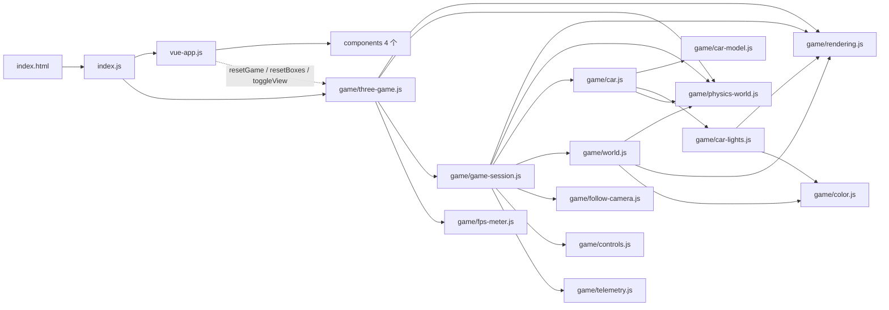
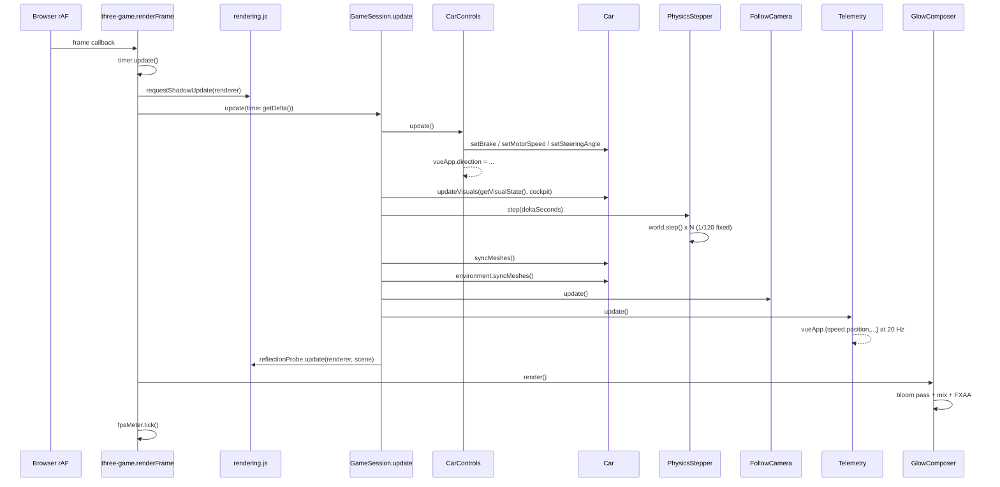
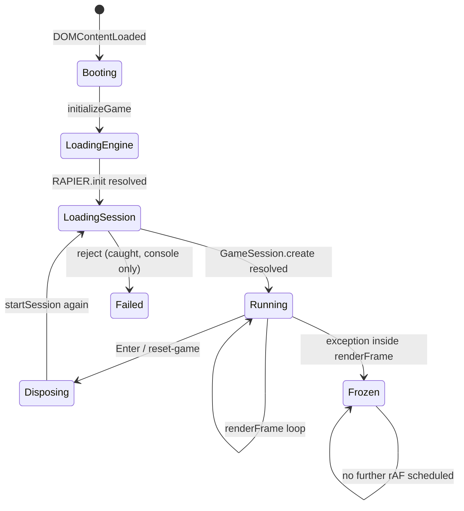
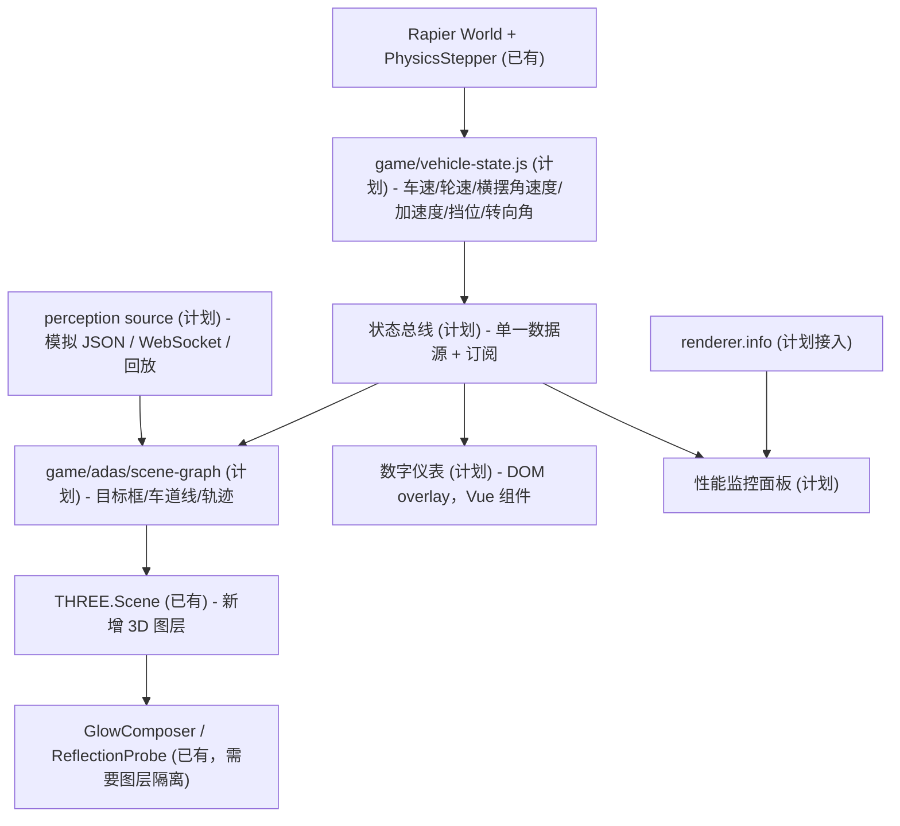
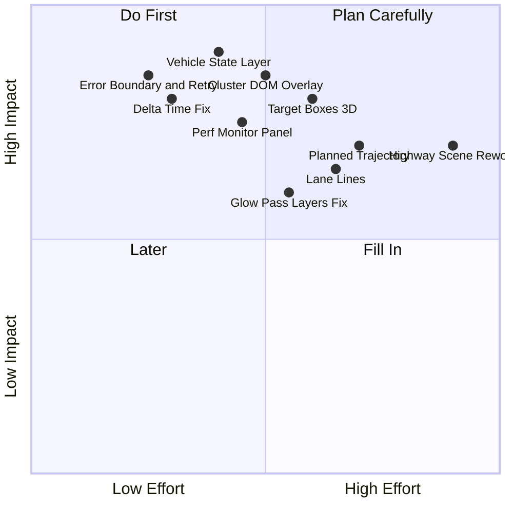

# Apex Cockpit — 代码库分析报告（Phase 1 / 只读）

> 分析对象：`/Users/zhoudaxia/Documents/newcode/apex-cockpit`（上游 `manuelhintermayr/three-js-car-example`，MIT，HEAD `454b49f`）
> 分析日期：2026-10-15 ｜ 方法：codebase-comprehension L1→L2→L3→L4 ｜ 本阶段**未修改任何源码**
> 证据标记：【已有】= 源码可验证；【推断】= 基于源码的推断/估算；【计划】= 尚未存在、Phase 2 新增

---

## 0. 阅读范围与方法（统计口径）

| 阶段 | 目标 | 实际读取 | 结论 |
|---|---|---|---|
| L1 | 技术栈 / 入口 / 规模 | `package.json`、`index.html`、`index.js`、目录树、`git log` | 26 文件 / 3213 行（js+vue+html+css）→ 小规模代码库 |
| L2 | 模块边界与依赖 | 全部 19 个 JS 模块的 `import` + 4 个 Vue 组件属性契约 | 13 个 game 模块 + 4 个 UI 组件 + 2 个入口模块 |
| L3 | 调用链与数据流 | `three-game.js`、`game-session.js`、`controls.js`、`telemetry.js`、`follow-camera.js` | 帧循环 + 5 条用户操作链路 |
| L4 | 深钻与风险 | `rendering.js`、`car.js`、`car-model.js`、`physics-world.js`、`index.html`；对照 three@0.185.1 构建产物 | 22 条性能/健壮性发现，14 条有源码证据 |

规模结论：**小规模（<1 万行）**，因此本报告按 skill 规定走完整 L1→L4，无优先级裁剪。虽然逐模块读完了全部文件，但仍按层递进组织结论，未做「一次读全再总结」的无序扫描。

---

## 1. 项目全景（L1）

### 1.1 技术栈【已有】

| 层 | 技术 | 版本/来源 | 证据 |
|---|---|---|---|
| 3D | Three.js | `0.185.1`（jsDelivr，**精确锁定**） | `index.html:13-14` |
| 物理 | Rapier3D（WASM） | `@dimforge/rapier3d-compat@0.20.0`（jsDelivr `+esm`） | `index.html:15` |
| UI | Vue 3（**全局构建**） | `unpkg.com/vue@3/dist/vue.global.js`，**未锁定版本** | `index.html:19` |
| 模型 | glTF 2.0 + Draco | `game/models/car.glb`，90 KB，33 mesh / 38 node / 1 material / 1 PNG 贴图 / **10398 三角形 / 0 动画 / 0 骨骼** | GLB 头部解析 |
| 模块化 | ES Modules + **import maps** | 无打包器、无 `node_modules` 运行时依赖 | `index.html:10-18`，`package.json:6` |
| 服务 | Python 静态服务器 | `npm start` → `python -m http.server 8080` | `package.json:7-13` |

**工程化现状（重要基线）**：无测试、无 lint 配置、无 CI、无 TypeScript、无 `node_modules`（`.gitignore:1` 只为备选方案预留）。`package.json` 里 4 个 serve 脚本（python / node / php）本质是同一个静态服务器。

### 1.2 目录结构与入口【已有】

```mermaid
graph TD
    ROOT["apex-cockpit/"] --> HTML["index.html - import map + DOM 组件挂载点"]
    ROOT --> IDX["index.js - DOMContentLoaded 引导"]
    ROOT --> VUE["vue-app.js - Vue 根实例 + 全部响应式状态"]
    ROOT --> PKG["package.json - 4 个静态服务器脚本"]
    ROOT --> COMP["components/ - 4 个 Vue 选项式组件"]
    ROOT --> CSS["css/ - 5 个样式表 539 行"]
    ROOT --> GAME["game/ - 13 个模块 2238 行"]
    ROOT --> DOCS["README / LICENSE / THIRD_PARTY_NOTICES"]
    COMP --> C1["info-panel.js - HUD + Debug 面板"]
    COMP --> C2["desktop-controls.js - 按键可视化"]
    COMP --> C3["mobile-controls.js - 摇杆 + 4 按钮"]
    COMP --> C4["fps-counter.js - FPS 徽标"]
    GAME --> G1["three-game.js - 组合根"]
    GAME --> G2["game-session.js - 一局的生命周期"]
    GAME --> G3["rendering.js - Renderer/Glow/反射探针"]
    GAME --> G4["physics-world.js - Rapier 世界 + 步进器"]
    GAME --> G5["car.js / car-model.js / car-lights.js"]
    GAME --> G6["world.js - 赛道/墙/塔/桥/箱子"]
    GAME --> G7["controls.js / follow-camera.js / telemetry.js / fps-meter.js / color.js"]
```



**初始化入口链**【已有】：
`index.html:20` 载入 `index.js` → `index.js:6` `DOMContentLoaded` → `index.js:10` `createVueApp()`（`vue-app.js:13`，`app.mount('#app')` 于 `vue-app.js:155`）→ `index.js:13` `initializeGame(vueApp)`（`game/three-game.js:21`）。

**注意**：Vue 先挂载、Three.js 后初始化，二者通过**传入同一个 `vueApp` 实例**耦合，没有事件总线、没有 store（详见 §2.4）。

### 1.3 构建与运行【已有】

- 运行：`python -m http.server 8080`（`package.json:8`），浏览器打开 `localhost:8080`。
- **无构建步骤**：`index.html` 用 import map 把裸模块名 `three` / `three/addons/` / `@dimforge/rapier3d-compat` 映射到 CDN（`index.html:10-18`），源码直接以 `.js` 发给浏览器。
- 全部三方库**运行时从 CDN 加载**（three/rapier/Draco 走 jsDelivr，Vue 走 unpkg）→ 离线不可用，且首屏依赖 4 个第三方域名的可用性【已有】。
- Draco 解码器路径与 three 版本绑定：`DRACO_DECODER_PATH = '.../three@0.185.1/examples/jsm/libs/draco/'`（`game/car-model.js:8`）→ 升级 three 必须同步改这一行，否则 GLB 解压失败【已有】。

---

## 2. 架构设计（L2）

### 2.1 模块职责表【已有】

| 模块 | 行数 | 职责 | 关键接口 | 依赖 |
|---|---|---|---|---|
| `game/three-game.js` | 105 | **组合根**：创建 renderer/composer/FPS 表，起停渲染循环，全局重置 | `initializeGame` `resetGame` `resetBoxes` `toggleView` `renderFrame` | rendering, physics-world, game-session, fps-meter |
| `game/game-session.js` | 105 | **一局聚合**：场景+物理世界+车+环境+相机+遥测的组装与每帧编排、释放 | `GameSession.create` `.update` `.resize` `.dispose` | 其余 7 个 game 模块 |
| `game/rendering.js` | 210 | WebGLRenderer、选择性辉光合成器、立方体反射探针 | `createRenderer` `requestShadowUpdate` `GlowComposer` `ReflectionProbe` `GLOW_LAYER` | three addons |
| `game/physics-world.js` | 79 | Rapier 世界、碰撞分组、固定步长累加器、刚体→Mesh 同步 | `initPhysicsEngine` `createPhysicsWorld` `PhysicsStepper` `syncMeshWithBody` `RAPIER` | rapier |
| `game/car.js` | 402 | **车的刚体装配**（底盘/转向节/车轴/车轮 + 关节电机 + 阿克曼）+ 座舱视觉动画 | `Car.create` `setMotorSpeed` `setBrake` `setSteeringAngle` `syncMeshes` `updateVisuals` | rapier, car-model, car-lights |
| `game/car-model.js` | 283 | GLB 加载一次，按节点名拆分为车身/4 轮/方向盘/踏板/挡杆/灯/玻璃，烘焙缩放与居中 | `loadCarModel` | GLTFLoader, DRACOLoader, BufferGeometryUtils |
| `game/world.js` | 252 | 静态影棚环境：赛道、四面墙、8 塔、桥、5 个可撞箱 | `createEnvironment` `KnockableBox` | rapier, rendering, color |
| `game/controls.js` | 138 | 键盘输入 → 每帧电机目标（速度/刹车/转向），合并触摸输入 | `CarControls.update` `getVisualState` `combineInputs` | 无（仅写 car + vueApp） |
| `game/follow-camera.js` | 128 | 追尾相机（惯性平滑）+ 座舱第一人称 + 鼠标环绕 + C 键切换 | `FollowCamera.update` `setCockpit` `lockTarget` `setCockpitRig` | three |
| `game/telemetry.js` | 126 | 车辆数据、圈速、碰撞与撞箱判定，20 Hz 写入 HUD | `Telemetry.update` `updateVehicleData` `detectCollision` `detectKnockedBoxes` | three（仅 MathUtils） |
| `game/car-lights.js` | 63 | 车灯 mesh 自发光 + 2 个 SpotLight（前灯投影） | `createCarLights` | three, rendering, color |
| `game/fps-meter.js` | 28 | 500 ms 窗口平均 FPS 回调 | `FpsMeter.tick` | 无 |
| `game/color.js` | 14 | Babylon 色彩空间兼容（sRGB 解释） | `babylonColor` | three |
| `vue-app.js` | 159 | Vue 根实例：**全部响应式状态**、触摸设备探测、重置/切视角转发 | `createVueApp` | three-game, 4 组件 |
| `components/*.js` | 513 | 4 个选项式组件（`template` 字符串，非 SFC） | props/emits 见 §2.4 | Vue 全局对象 |

### 2.2 依赖图（L2）【已有】



**结构判断**【已有】：依赖是**单向分层**的（组合根 → 会话 → 领域模块 → 基础设施），没有循环依赖（唯一的"反向"引用是 `vue-app.js ⇄ three-game.js` 的公开 API 调用，`vue-app.js:3` 导入三个函数，`three-game.js:26` 回调写 `vueApp.fps`）。
`game/` 内 13 个模块中，`controls.js` / `telemetry.js` / `follow-camera.js` 是**只写 `vueApp` 的叶子**，这正是 Phase 2 要切开的数据缝（§6.1）。

### 2.3 三个核心关系【已有】

**(a) 场景管理**：没有独立 SceneManager。每局由 `createScene()`（`game-session.js:78`）**新建一个 `THREE.Scene`**，环境由 `createEnvironment(scene, world)`（`world.js:112`）挂载，车由 `createCar(scene, world)`（`car.js:163`）挂载。场景对象与 `GameSession` 生命周期强绑定，重置即整场重建（`three-game.js:44-57`）。
**关键设计**：GLB 派生的几何体/材质用 `markShared()` 打标（`car-model.js:280`），跨场景复用；`disposeSceneResources()`（`game-session.js:90`）遍历场景时跳过 `userData.shared`，避免把缓存资产释放掉。这是本项目最值得保留的资产管理设计。

**(b) Renderer 与 Camera**：`WebGLRenderer` + `GlowComposer` + `FpsMeter` 是**模块级单例**（`three-game.js:10-13`），跨重置存活；相机是**每局新建**（`follow-camera.js:20`，由 `game-session.js:41` 创建），矩阵每帧由 `update()` 直接写。相机的投影参数变更集中在 `setCockpit`/`setAspect`（`follow-camera.js:61-70`），都调用了 `updateProjectionMatrix()`。

**(c) 状态管理**：**唯一状态中心是 Vue 实例的 `data()`**（`vue-app.js:23-55`）。Three/Rapier 侧状态（关节电机、刚体位姿）留在模块内的类实例上，**单向**流入 Vue：

| 状态 | 存放位置 | 写入者 | 读取者 | 频率 |
|---|---|---|---|---|
| 按键按下 | `CarControls.pressed`（`controls.js:35`） | 键盘事件 | `combineInputs` | 事件驱动 |
| 触摸输入 | `vueApp.touchControls`（`vue-app.js:30`） | `onTouchControlsUpdate`（`vue-app.js:140`） | `combineInputs`（`controls.js:101`） | 触摸事件 |
| 车速/位置/朝向 | `vueApp.{speed,position,rotation,maxSpeed}` | `Telemetry.updateVehicleData`（`telemetry.js:59`） | `InfoPanel` props | 20 Hz |
| 方向文案 | `vueApp.direction` | `CarControls.update`（**`controls.js:82`，每帧**） | `InfoPanel` | 每帧（值不变则不触发渲染） |
| 碰撞/撞箱/圈速 | `vueApp.{collisions,knockedBoxes,raceTime,isRacing}` | `Telemetry`（`telemetry.js:79/98/120`） | `InfoPanel` | 事件驱动 |
| FPS | `vueApp.fps` | `FpsMeter` 回调（`three-game.js:25`） | `FpsCounter` | 2 Hz |
| 座舱/追尾视角 | `FollowCamera.cockpit`（`follow-camera.js:28`） | `setCockpit`（C 键 / 移动端按钮） | `GameSession.update` 决定相机分支 + 踏板动画 | 切换时 |

**没有** Pinia/Vuex，**没有** Three 侧的事件系统，**没有** ECS。对 Phase 2 的含义：新增「车辆状态 / 感知目标 / 轨迹」数据需要一个显式的数据层，否则会继续往 `vueApp.data()` 上堆（§6.1）。

---

## 3. 核心调用链（L3）

### 3.1 每帧主链（requestAnimationFrame → 场景更新）【已有】

触发点：`renderer.setAnimationLoop(renderFrame)`（`game/three-game.js:32`）。



**执行顺序的设计意图**【已有】：`controls.update()` 先设定电机目标 → `updateVisuals()` 先做纯视觉插值 → `stepper.step()` 推进物理 → `syncMeshes()` 把物理位姿写回渲染对象 → 相机 → 遥测 → 反射。顺序合理，且**视觉与物理解耦**（座舱动画不进物理）。

### 3.2 五条用户操作链（真实文件 + 函数）

| # | 用户操作 | 入口函数 | 状态变化 | 3D 更新 | 证据 |
|---|---|---|---|---|---|
| 1 | 按 `W` 前进 | `CarControls.onKeyDown` → `handleKey` | `pressed.forward = true` | 下一帧 `updateSpeed` → `car.setMotorSpeed` → Rapier `configureMotorVelocity` → `world.step` → `syncMeshes` | `controls.js:42,53,65,85,122`；`car.js:82` |
| 2 | 按 `A/D` 转向 | 同上 → `updateSteering` | `currentSteeringAngle ±0.05`，无输入时 ×0.85 回正 | `car.setSteeringAngle` → `makeAckermann`（`car.js:393`）算出内外轮角 → 两个转向关节 `configureMotorPosition` | `controls.js:112-120`；`car.js:95-99,393-401` |
| 3 | 按 `Space` 跳跃 | `handleKey` → `car.jump()`（瞬时）+ `update()` 中 `car.holdJump()`（持续） | 无 UI 状态 | `body.applyImpulse` + 直接改写 `linvel`（`car.js:102-114`） | `controls.js:67-69,77-79` |
| 4 | 按 `Enter` 重置 | `handleKey` → `vueApp.resetGame()` | 14 个响应式字段清零（`vue-app.js:66-82`） | `three-game.resetGame`：停循环 → `session.dispose()` → 重建 scene/world/car/env → 重启循环 | `controls.js:54-59`；`vue-app.js:65-86`；`three-game.js:44-57` |
| 5 | 按 `C` / 移动端 📷 切视角 | `FollowCamera.onKeyDown` → `setCockpit` ；或 `MobileControls.onToggleView` → `emits` → `vue-app.onToggleView` → `three-game.toggleView` → `setCockpit` | `followCamera.cockpit` + `camera.fov` 45.8↔74 | `updateCockpit()` 用车身 `matrixWorld` 变换座舱 rig（`follow-camera.js:94-100`） | `follow-camera.js:41-45,61-65`；`mobile-controls.js:145`；`vue-app.js:148`；`three-game.js:72` |
| 6 | 移动端摇杆 | `MobileControls.initTouchControls` 内 `handleMove` | `touchControls.{forward,...}` → deep watcher → `$emit` → `vue-app.onTouchControlsUpdate` | 同链 1，经 `combineInputs` 合并 | `mobile-controls.js:72-101,33-40`；`vue-app.js:140`；`controls.js:100-110` |

**触摸设备判定的双通道设计**【已有】：`detectTouchOnly()`（`vue-app.js:92`）同时用 `matchMedia('(hover: none) and (pointer: coarse)')` + `(any-hover: hover)` 做能力探测，并监听首次 `touchstart`/`mousedown` 做运行时切换（`vue-app.js:110-131`）；后者是**没有对应 remove 的 window 监听**（见 §5.5 泄漏 R3）。

### 3.3 一局的生命周期（状态机）【已有】



`Failed` 与 `Frozen` 都**没有恢复路径、没有用户可见提示**（`three-game.js:37` 只有 `console.error`），见 §5.6。

---

## 4. 渲染机制（L3/L4）

### 4.1 "requestAnimationFrame" 的真相【已有】

项目**没有直接调用 `requestAnimationFrame`**，而是用 `renderer.setAnimationLoop(renderFrame)`（`three-game.js:32`）并在重置时 `setAnimationLoop(null)`（`three-game.js:47`）。three@0.185.1 内部 `WebGLAnimation` 的实现（构建产物 `build/three.module.js`，`function WebGLAnimation()` 内局部函数 `onAnimationFrame`）：

```js
function onAnimationFrame( time, frame ) {
    animationLoop( time, frame );
    requestId = context.requestAnimationFrame( onAnimationFrame );
}
```

两个结论【已有】：① `setAnimationLoop` 是 WebXR 就绪的 rAF 封装；② **回调抛异常时下一帧不会被排程**——渲染循环会永久停止（`requestShadowUpdate`/`session.update`/`glowComposer.render()` 任一抛出即触发，见 §5.6）。

### 4.2 每帧的 GPU 工作清单【推断，基于代码路径】

`renderFrame()`（`three-game.js:85`）→ `GlowComposer.render()`（`rendering.js:113`）→ `ReflectionProbe.update()`（`rendering.js:161`）三条路径叠加后，**每帧对场景的遍历次数**：

| # | Pass | 触发点 | 渲染内容 | 分辨率 |
|---|---|---|---|---|
| 1 | 阴影贴图 | `requestShadowUpdate`（`three-game.js:87`）+ `shadowMap.autoUpdate=false`（`rendering.js:56`） | 仅 castShadow 对象；唯一投影灯是前灯 SpotLight（`car-lights.js:58-62`） | 1024² |
| 2 | 立方体反射 | `ReflectionProbe.update`（`rendering.js:161`） | 整场景（车身隐藏）**1 个面/帧**，首帧 6 面 | 128² ×6 |
| 3 | 辉光 Pass | `bloomComposer.render()`（`rendering.js:126`） | 整场景（非辉光对象换成黑色材质 + 黑色背景） | 全屏 ×0.25 |
| 4 | 最终 Pass | `finalComposer.render()`（`rendering.js:133`） | 整场景原材质 + mix + Output + FXAA | 全屏 ×1（DPR 固定 1） |

场景对象数【推断，逐行清点】：赛道 1 + 墙 4 + 塔 8 + 桥台 1 + 桥柱 6 + 箱子 5 = 25 个环境 mesh；车身 1 + 玻璃 1 + 方向盘 1 + 转向柱 1 + 油门 1 + 刹车 1 + 挡杆 1 + 前灯 1 + 尾灯 1 + 车轮 4 = 13 个车辆 mesh。合计 **38 个 Mesh**（另有 3 个 Light）。
→ 每帧约 **4 × 30~38 ≈ 120~150 次 draw call**（阴影 pass 只画 castShadow 子集，故取区间）。**没有** InstancedMesh、没有 LOD、没有合批；`world.js` 的 8 座塔各一个 `BoxGeometry`（`world.js:236`）本可 InstancedMesh 化。

### 4.3 后处理与"选择性辉光"【已有】

`GlowComposer`（`rendering.js:71`）搭了两个 composer：
- `bloomComposer`：`RenderPass` + `UnrealBloomPass`（strength 1.5 / radius 0.6 / threshold 0，`rendering.js:17`），目标是 0.25 分辨率的 HalfFloat RT（`rendering.js:80`，`GLOW_RESOLUTION_SCALE`）。
- `finalComposer`：`RenderPass` + 自定义 `mixPass`（`baseTexture + bloomTexture`，`rendering.js:33-40,85-92`）+ `OutputPass` + `FXAAPass`。
- **选择性**的实现方式（照搬 three 官方 `webgl_postprocessing_unreal_bloom_selective`，见 `THIRD_PARTY_NOTICES.md`）：开渲染前把场景 `background` 换成黑色、把所有**不在** `GLOW_LAYER(=1)` 上的 mesh 材质临时替换为共享黑材质（`rendering.js:121-131`），渲染完还原。`dimmedMeshes` 列表按场景缓存一次（`rendering.js:115-117`，`collectNonGlowingMeshes` 于 `198`）。
- 谁发光：5 个橙色箱子（`world.js:214`）、前灯/尾灯 mesh（`car-lights.js:41`）。

### 4.4 材质与光照【已有】

| 对象 | 材质 | 参数 | 证据 |
|---|---|---|---|
| 车身 + 4 轮 + 方向盘/踏板/挡杆 | **单一共享** `MeshStandardMaterial`（来自 GLB） | `metalness 0.85`、`roughness 0.25`（覆盖 GLB 的 0/0.5），`envMap` = 立方体探针，`envMapIntensity 2.2` | `car-model.js:55-59`；`rendering.js:156-157` |
| 玻璃 | 独立 `MeshStandardMaterial` | `transparent opacity 0.35`、`depthWrite false`、`DoubleSide` | `car.js:191-199` |
| 环境 | `MeshPhongMaterial` | `color` + `specular`，经 `babylonColor()` 按 sRGB 解释 | `world.js:250-252`；`color.js:12` |
| 车灯 | `MeshStandardMaterial` 自发光 | 前灯 `emissiveIntensity 1.8`（暖白）、尾灯 `1.1`（红，更亮所以更低） | `car-lights.js:15-23,38` |

光照共 3 个：1 个 `HemisphereLight`（`game-session.js:82`，强度 0.7）+ 2 个 `SpotLight`（前灯强度 180/range 60/`castShadow` 1024²；尾灯 26/22 不投影，`car-lights.js:47-62`）。**没有** DirectionalLight、**没有** 环境光遮蔽、**没有** IBL 预滤波（envMap 来自实时 cube 探针）。

### 4.5 模型"动画系统"的真相【已有】

**没有动画系统**：GLB 内 `animations: 0`、`skins: 0`（GLB 头部实测）。所有动效都是**逐帧程序化**：

| 动效 | 实现 | 证据 |
|---|---|---|
| 车辆运动 | 物理刚体位姿 → `syncMeshWithBody` 直接写 `position/quaternion` | `car.js:116-121`；`physics-world.js:72-77` |
| 车轮滚动/转向 | Rapier 中轮体本身是被约束的刚体，mesh 跟随 | `car.js:305-320` |
| 方向盘 | `setRotationFromAxisAngle(steeringAxis, -steerAngle × 4)` | `car.js:131`，`STEERING_WHEEL_RATIO` 于 `34` |
| 油门/刹车踏板 | 指数插值（`+= (target - cur) × 0.25`），**仅座舱视角** | `car.js:136-143`，`PEDAL_SMOOTHING` 于 `37` |
| 挡杆 | 同样插值，所有视角都动 | `car.js:146-153`，`SHIFTER_SMOOTHING` 于 `38` |
| 相机 | 追尾：位置增量 + 速度钳制；座舱：刚性绑定车身矩阵 | `follow-camera.js:81-90`，`94-100` |

---

## 5. 性能与健壮性审查（L4）

分级：**P0** = 会致功能不可用/难排查；**P1** = 明显影响体验或可维护性；**P2** = 优化项。

### 5.1 Draw Call 与重复渲染

| 编号 | 发现 | 证据 | 影响 | 级别 |
|---|---|---|---|---|
| D1 | 辉光 pass 用"把 38 个对象全画一遍、非辉光对象材质换黑"的方式实现 → 每帧多一次全场景绘制 | `rendering.js:113-134` + `198-206` | 【推断】每帧多 ~30 draw call；若改用 `camera.layers.set(GLOW_LAYER)` 只画 7 个发光对象，可省掉这次全场景遍历 | P1 |
| D2 | 阴影贴图 `autoUpdate=false` 却在 `renderFrame` 里每帧 `needsUpdate=true` | `rendering.js:56,64`；`three-game.js:87` | 每帧重画 1024² 阴影贴图，等于放弃了 `autoUpdate=false` 的收益；可改为每 N 帧或仅尾灯/前灯变化时更新 | P1 |
| D3 | 反射探针每帧渲染 1 个 cube face（6 帧/循环） | `rendering.js:168-190` | 稳定的额外一次全场景渲染；`REFLECTION_PROBE_SIZE=128` 已相对便宜，但可在静止时暂停 | P2 |
| D4 | 重置后首帧要一次性渲 6 个 face | `rendering.js:170-172`（`hasFullCapture` 分支） | 【推断】Enter 重置会有一次可见卡顿 | P2 |
| D5 | 8 座塔 / 4 面墙各用独立 `BoxGeometry`，无实例化 | `world.js:236`, `160` | 环境 mesh 数 25，可用 `InstancedMesh` 降到个位数 | P2 |
| D6 | DPR 被钉死为 1（`MAX_PIXEL_RATIO = 1`） | `rendering.js:14,50` | Retina 上偏软，但这是**有意**的（注释说明对齐 Babylon 原版并按 CSS 像素渲染）；改 HMI 时需重新决策 | P2（设计权衡） |

### 5.2 帧率耦合（架构级问题，面试高频）

| 编号 | 发现 | 证据 |
|---|---|---|
| F1 | **只有物理用 delta**：`GameSession.update(deltaSeconds)` 仅把它传给 `stepper.step` | `game-session.js:54-57` |
| F2 | 车速/转向按**每帧**增量累积，与帧率绑定 | `controls.js:5-9`（`ACCELERATION_PER_FRAME=1`、`STEERING_STEP=0.05`、`NATURAL_SLOWDOWN=0.92`），用于 `updateSpeed:122` / `updateSteering:112` |
| F3 | 相机平滑也是每帧常数 | `follow-camera.js:13-14`（`cameraAcceleration: 0.035`、`maxCameraSpeed: 10`），用于 `update:81-86` |
| F4 | 座舱插值系数同为每帧常数 | `car.js:37-38,138,152` |

后果【推断】：144 Hz 屏幕上油门加速更快、相机更"跟手"；30 Hz 时相反。物理侧已经用累加器（`physics-world.js:54-64`）正确处理，说明作者意识到了时间步问题，只是没推广到控制与相机层。**这是 Phase 2 必须先修的一条**（也是很好的面试谈资）。

### 5.3 资源释放与内存

| 编号 | 发现 | 证据 | 评价 |
|---|---|---|---|
| R1 | GLB 几何/材质跨局复用：`markShared()` 打标 → `disposeSceneResources` 跳过 | `car-model.js:280`；`game-session.js:95-103` | 【已有】正确且关键的设计 |
| R2 | 每局释放：`CarControls.dispose`（window keydown/up）、`FollowCamera.dispose`（pointer 3 个 + keydown）、`ReflectionProbe.dispose`（RT）、`world.free()` | `game-session.js:69-75`；`controls.js:48-51`；`follow-camera.js:118-123`；`rendering.js:192-194` | 【已有】覆盖到位 |
| R3 | **`vue-app.js` 的 4 个 window 监听没有移除**（`touchstart/touchmove/mousedown/mousemove`），`beforeUnmount` 只摘了 2 个 matchMedia | `vue-app.js:126-131` vs `59-63` | 【已有】真实泄漏点；当前 App 从不卸载，影响为"潜在" |
| R4 | **`MobileControls` 的 4 个 document 监听没有移除**（`touchmove/touchend/mousemove/mouseup`），`beforeUnmount` 只清 interval | `mobile-controls.js:121-127` vs `174-180` | 【已有】同上 |
| R5 | `CubeCamera` 的 6 个内部相机未 dispose | `rendering.js:148` | 【推断】无 GPU 资源，影响可忽略 |
| R6 | `GlowComposer.hiddenMaterials` 每帧 `clear()` | `rendering.js:130` | 【已有】无残留 |
| R7 | 无 `renderer.info` 采集，无纹理/几何体计数，无内存监控 | 全库 grep 无 `renderer.info` | 【已有】盘面可见性缺口（§6.5 要补） |

### 5.4 异步加载与异常处理

| 编号 | 发现 | 证据 | 级别 |
|---|---|---|---|
| A1 | **缓存 Promise 的反模式（两处）**：`engineReady = RAPIER.init()` 与 `modelPromise = loadAndPrepare()` 把**失败也缓存**，一次 CDN 抖动即永久失败，无重试 | `physics-world.js:24-28`；`car-model.js:41-46` | P0 |
| A2 | 启动失败只 `console.error`，无用户可见错误态、无降级 | `three-game.js:29-37`（`.catch(error => console.error(...))`） | P0 |
| A3 | **渲染循环内的异常会让循环永久停止**（three `WebGLAnimation.onAnimationFrame` 先调回调、后排队下一帧） | 构建产物 `build/three.module.js`；调用点 `three-game.js:85-91` | P0 |
| A4 | `resetGame` 若在 `startSession` 中抛错，循环已在 `three-game.js:47` 被停，游戏直接"黑屏无响应" | `three-game.js:44-57` | P0 |
| A5 | 显式 `throw` 只有两处（模型缺轮子、凸包构建失败） | `car-model.js:120`；`car.js:264-266` | — |
| A6 | 无加载进度 UI：GLB 90 KB 尚可，但 Draco 解码器 + WASM 首次加载无任何指示 | `car-model.js:94-97`；`index.html:15` | P2 |

### 5.5 数据/单位一致性问题

| 编号 | 发现 | 证据 |
|---|---|---|
| U1 | HUD 把物理单位速度直接标成 `km/h`，**没有换算**；`physics-world.js:8` 定义了 `UNITS_PER_METER = 8` 却从未用于单位换算 | `components/info-panel.js:16,72`；`physics-world.js:8`；`telemetry.js:37-38,63` |
| U2 | `MAX_SPEED = 80` 是**电机角速度目标**，不是车速；HUD 上会显示到 80 "km/h" 但物理上完全不是 | `controls.js:3`；`car.js:82-86` |
| U3 | `direction` 每帧写、其余 HUD 20 Hz 写：写入频率不一致（值不变时 Vue 不触发渲染，所以代价小，但语义混乱） | `controls.js:82`；`telemetry.js:11,49-57` |

### 5.6 依赖与可复现性

| 编号 | 发现 | 证据 |
|---|---|---|
| S1 | three / rapier / Draco **锁定精确版本**，Vue **完全未锁版本**（`vue@3` → 跟随最新 v3） | `index.html:13-19` |
| S2 | 全部依赖运行时从 CDN 拉取：无离线能力、无 SRI、无自托管方案 | `index.html:10-19`；`car-model.js:8` |
| S3 | 无测试/CI/lint/类型检查 → 物理调参（`car.js:8-31` 一堆魔数）只能靠肉眼回归 | 全库无 test/config 文件 |

---

## 6. 二次开发方案（面向车载座舱 HMI / 智驾可视化作品集）

### 6.1 目标架构与"切缝"【计划】

现有最大的结构性限制：**车辆状态由 `Telemetry` 直接写进 Vue，3D 世界无处消费结构化数据**。把它切开，Phase 2 的所有新功能都能挂上去：



**建议的落点（尽量少改现有文件）**：
1. 新增 `game/vehicle-state.js`：纯计算模块，输入 `car`/`stepper`，输出不可变快照。**不碰 Three、不碰 Vue** → 可用 `node:test` 单测。
2. 新增 `game/state-bus.js`（或直接用 `reactive()` + `effectScope`）：唯一数据源，替换 `telemetry.js` 里对 `vueApp.*` 的直写（保留 `Telemetry` 的判定逻辑，改成 publish）。
3. 新增 `game/adas/` 目录：`targets.js` / `lanes.js` / `trajectory.js`，各自导出 `create*(scene)` 与 `update(snapshot)`；图层用 `THREE.Layers` 独立分配（规避 D1 与反射探针污染）。
4. `GameSession.update` 增加两行：`this.vehicleState.update(); this.adas.update(this.vehicleState.snapshot)`。
5. 先落 **F1-F4 时间步修正**（把 `deltaSeconds` 传进 `controls.update(dt)` / `followCamera.update(dt)`），否则高刷屏上新增的轨迹预测会跟着油门一起跑偏。

### 6.2 数字仪表（Digital Cluster）【计划】

- **推荐 DOM overlay**（复用现有 `components/` + `css/` 体系 + Vue 响应式），不推荐第二套 WebGL 场景（现有 renderer/composer 是单例，双 canvas 会带来 2 倍合成成本，且 D6 已把 DPR 钉死）。
- 结构：`components/cluster/` 下拆分 `speed-gauge.js`、`gear-indicator.js`、`power-bar.js`、`adas-status-icons.js`；样式新增 `css/cluster.css`，沿用 `z-index: 1000` 层级约定（`css/info-panel.css:47`）。
- 数据：全部来自 §6.1 的状态总线；`speed` 必须经 `UNITS_PER_METER`（`physics-world.js:8`）换算为 m/s → km/h，修掉 U1/U2。
- 复用现成轮子：`FpsCounter`（`components/fps-counter.js`）的 props/computed 模式可直接照抄到仪表子组件。
- 车载 HMI 加分项：安全色板（ISO 2575 图标语义）、告警优先级分级、帧率与刷新解耦（仪表 20 Hz 足够，避免与 3D 抢主线程）。

### 6.3 车辆状态数据层【计划】

| 信号 | 数据来源（现有可拿到的） | 备注 |
|---|---|---|
| 车速 | `car.linearVelocity()`（`car.js:72`） | 现成 |
| 纵向/横向加速度 | `linvel` 差分 / `dt` | 需做低通滤波，否则抖动 |
| 横摆角速度 | `car.yaw()` 差分（`car.js:77-80`） | 现成函数可复用 |
| 四轮转速 | Rapier 轮体 `angvel()`（`car.js:304,358` 创建的 body） | 【推断】需把轮体引用暴露出来 |
| 方向盘转角 | `controls.currentSteeringAngle`（`controls.js:37`）→ `Car.setSteeringAngle` | 现成 |
| 挡位 | 目前不存在（只有挡杆**视觉**倾斜 `car.js:146-153`） | 需新增状态机（P/R/N/D） |
| 电机/刹车力矩 | `DRIVE_MOTOR`（`car.js:30`）配置 + `setBrake` 分支 | 可导出为指示量 |
| 碰撞事件 | `Telemetry.detectCollision`（`telemetry.js:89`） | 已有，改为事件发布 |
| 圈速/里程 | `Telemetry.updateRaceTimer`（`telemetry.js:82`） | 已有 |

### 6.4 智驾可视化三件套【计划】

| 功能 | 实现建议 | 与现有代码的冲突点 |
|---|---|---|
| **目标框**（车辆/行人/锥桶） | 每目标一个 `Box3Helper`-风格线框 + 速度矢量箭头 + 文字标签（`Sprite` + canvas 纹理）；用对象池复用，避免每帧 new | 会被 **D1 辉光 pass** 与 **反射探针**渲染一遍（`rendering.js:126,186`）→ 必须用 Layers 隔离并在探针捕获时排除 |
| **车道线** | `CatmullRomCurve3` + `TubeGeometry`（或 `Line2`/`LineMaterial` 以支持线宽）；三次贝塞尔拟合带曲率 | 同上；透明材质会进 `dimmedMeshes` 列表（`rendering.js:198` 只按 layer 判定） |
| **规划轨迹** | 折线 + 渐隐（`Line2` 分段透明度）或 `TubeGeometry` + 流动贴图；预测时域用颜色映射（TTC/风险） | 需要 `update(dt)` 的时间基准 → 依赖 F1-F4 修复 |
| 数据源 | **先用回放 JSON**（离线可复现、作品集演示不依赖后端），再留 `WebSocket` 适配器 | 无现成网络层 |

**渲染层预算提示**【推断】：ADAS 图层若每帧新增 50 个目标框 + 3 条轨迹，在现有 4-pass 结构下会成倍放大 → 建议同步实施 D1（layers 化辉光）+ 给 ADAS 图层关闭反射可见性。

### 6.5 性能监控面板【计划】

在 `FpsMeter`（`fps-meter.js:6-27`，当前只有 500 ms 平均）基础上扩展为 `game/perf-monitor.js`：
- 帧时间：p50/p95/p99 + 最近 N 帧直方图（`performance.now()` 差）。
- GPU 侧：`renderer.info.render.calls / triangles / textures / geometries`（现无采集，R7）。
- 物理侧：`PhysicsStepper` 的每帧 `steps` 数与 `accumulator` 水位（`physics-world.js:57-63` 内可暴露）。
- 渲染管线：4 个 pass 的耗时（用 `EXT_disjoint_timer_query_webgl2` 可选，或 CPU 侧包一层计时）。
- 展示：独立 overlay panel，默认隐藏、F12/` 键切换（复用 `InfoPanel.handleGlobalKeydown` 的快捷键约定，`info-panel.js:114-122`）。
- 这条本身就是**面试硬通货**：能拿出"我把 draw call 从 ~140 降到 ~X"的真实数据。

### 6.6 二次开发优先级【计划】



| 优先级 | 任务 | 理由 | 预计工作量 |
|---|---|---|---|
| **P0** | 渲染循环错误边界 + 加载重试（A1/A2/A3/A4） | 现在一次异常=整个 demo 死掉，作品集演示不可接受 | 0.5 天 |
| **P0** | delta time 修正（F1-F4） | 高刷屏/低帧率下行为不一致，且新功能都建立在时间步上 | 0.5 天 |
| **P0** | 车辆状态层 + 状态总线（§6.1/6.3）+ 单位换算（U1/U2） | 所有新功能的公共地基 | 1 天 |
| **P1** | 数字仪表（DOM overlay） | 岗位最直接的对话点 | 1.5 天 |
| **P1** | 性能监控面板 | 用数据证明优化，配合 D1/D2 | 1 天 |
| **P1** | 目标框 3D 可视化 + 回放数据源 | ADAS 可视化的核心演示 | 2 天 |
| **P2** | 辉光 pass layers 化 + 阴影节流（D1/D2） | 为 ADAS 图层腾出渲染预算 | 1 天 |
| **P2** | 车道线 + 规划轨迹 | 完整度提升 | 2 天 |
| **P3** | 高速公路场景重做（`world.js` 参数化） | 视觉说服力 | 2-3 天 |
| **P3** | 测试与 CI（对纯模块跑 `node:test`） | 工程可信度 | 1 天 |

---

## 7. 面试准备：20 个基于本仓库真实源码的问题

**Q1. 这个项目为什么不需要打包工具？import map 在这套架构里做了什么？**
【已有】`index.html:10-18` 用 import map 把裸模块名映射到 CDN URL，浏览器原生 ESM 直接解析 `import * as THREE from 'three'`。好处：零构建、调试即源码、无 node_modules 运行时。边界：需要 Chrome≥89（`package.json` browserslist 与 import map 落地版本一致）；无法 tree-shaking（`three.module.js` 整包 ~650 KB）；无法做 TS/JSX/路径别名；依赖 CDN 可用性（S2）。

**Q2. `renderer.setAnimationLoop` 和 `requestAnimationFrame` 有什么区别？为什么用它？**
【已有】`three-game.js:32` 用前者。它是 three 对 rAF 的封装（构建产物里的 `WebGLAnimation`），额外支持 WebXR 的 XRFrame 回调；停止方式是 `setAnimationLoop(null)`（`three-game.js:47` 重置时用）。关键差异：`onAnimationFrame` 先执行回调再排程下一帧，所以回调抛异常会导致循环停止（见 Q14）。

**Q3. 这一帧里场景被渲染了几次？分别是为什么？**
【已有】约 4 次：① 阴影贴图（`three-game.js:87` → `rendering.js:64`，唯一投影灯是前灯 SpotLight，`car-lights.js:58-62`）；② 反射探针 1 个 cube face（`rendering.js:161-190`）；③ 辉光 pass 的全场景（`rendering.js:126`）；④ 最终 pass 的全场景（`rendering.js:133`）。38 个 mesh → 【推断】~120-150 draw call/帧。

**Q4. "选择性辉光"是怎么做的？代价是什么？换你你怎么改？**
【已有】照搬 three 官方 example：渲染前把非 `GLOW_LAYER` 的 mesh 材质替换为共享黑材质、背景置黑（`rendering.js:121-131`），让 UnrealBloomPass 只看到发光物；`dimmedMeshes` 按场景缓存（`rendering.js:115-117,198-206`）。代价：整场景仍然被绘制一遍（D1）。更优：给 `RenderPass.camera` 按 layer 过滤（发光物单独一层），让 bloom pass 只画 7 个对象；注意 `dimmedMeshes` 缓存与场景重建的失效关系（`rendering.js:105` 已在 `setScene` 里重置）。

**Q5. 阴影贴图设了 `autoUpdate = false`，但每帧 `needsUpdate = true`，这是什么权衡？**
【已有】`rendering.js:52-56,64` + `three-game.js:87`。注释写明了动机：一帧内场景被渲染多次（探针/辉光/最终），若用 `autoUpdate` 可能被重复计算。当前实现的实际效果=每帧更新一次，等于回到 `autoUpdate`，但**语义更明确且可调**。可优化：车与灯相对静止时跳过（比如每 2-3 帧），或用更小的 `shadow.mapSize`。

**Q6. 物理为什么用累加器 + 固定步长？`MAX_STEPS_PER_FRAME = 8` 意味着什么？**
【已有】`physics-world.js:46-65`：`timestep = 1/120`（`physics-world.js:5`），累加器吸收帧时间，最多 8 步/帧（`physics-world.js:6`），且累加器被 `Math.min(delta, timestep*8)` 截断（`:55`）。含义：低到 15 fps 仍能实时；低于 15 fps 时仿真会**变慢**（时间膨胀）而不是爆炸——这是刻意的取舍。对比：控制/相机层没享受这套待遇（Q10）。

**Q7. 车是单体刚体还是刚体拼装？前轮的自由度链是什么？**
【已有】拼装。前轮链：`chassis -[revolute Y: 转向]- knuckle -[prismatic Y: 悬挂]- axle -[revolute X: 自转]- wheel`（`car.js:277-321`）；后轮省掉转向节：`chassis -[prismatic Y]- axle -[revolute X]- wheel`。底盘用 GLB 顶点做 `convexHull`，并显式设质量/质心/惯量（`car.js:256-275`），质心刻意压到轮心上方（`CHASSIS.centerOfMass.y = -2.5`，`car.js:13`）以防翻车。

**Q8. 阿克曼转向怎么算、怎么施加？**
【已有】`makeAckermann(model)`（`car.js:393-401`）用轴距/轮距算出内外轮转角，`setSteeringAngle` 把两个角分别喂给左右转向关节的位置马达（`car.js:95-99`）；转向马达刚度极大（`STEERING_MOTOR.stiffness = 2e7`，`car.js:29`）以便原地回正。

**Q9. 碰撞分组为什么这么设？车零件之间为什么不碰？**
【已有】`physics-world.js:11-16`：`CarParts = (0x0001 << 16) | 0x0002`——只与环境碰撞；`Environment = (0x0002 << 16) | 0xffff`。这样车轮/底盘/转向节之间免于自碰撞，关节链不会被"自己撞自己"的接触力破坏，同时省掉大量 narrow-phase 计算。

**Q10. 相机跟随哪里和帧率耦合？怎么修？**
【已有】`follow-camera.js:81-86` 每帧按固定系数 `cameraAcceleration = 0.035` 逼近目标（`:13`），`clampSpeed` 上限也是"每帧"概念（`:14,126-128`）；`update()` 根本不接收 dt（`game-session.js:60` 也没传）。修法：`update(dt)`，用 `1 - Math.pow(1 - k, dt * 60)` 形式的指数平滑，速度钳制改成"每秒"。同样的病在 `controls.js:112-132`（Q19）。

**Q11. 反射探针怎么避免拍到车自己？每帧只更新一个 cube face 的原理？**
【已有】捕获期间把车身材质 `visible = false`（`rendering.js:167,174`），车灯不受影响（仍照亮反射）。首帧 `cubeCamera.update()` 一次性 6 面（`rendering.js:171`），之后每帧只渲染 `this.nextFace` 一面，6 帧一个循环（`rendering.js:177-190`）；因为 mipmap 覆盖全部面，只在**最后一个面**渲染时打开 `generateMipmaps`（`rendering.js:184`）避免每帧重建。

**Q12. 重置时哪些 GPU 资源被释放、哪些必须保留？靠什么机制区分？**
【已有】`disposeSceneResources`（`game-session.js:90-104`）遍历场景释放 geometry/material（跳过 `userData.shared`）与 Light；`ReflectionProbe.dispose` 释放 cube RT；`world.free()` 释放物理世界。必须保留的是 GLB 派生的几何与共享材质——`markShared()` 在 `car-model.js` 里对 body/轮/踏板/挡杆/方向盘/灯/玻璃统一打标（`:70,87-89,166,233,240,250,260,280`），这样"重置=重建世界但不重下模型"。

**Q13. 代码里有两处缓存 Promise 的写法，问题在哪？**
【已有】`physics-world.js:24-28` 的 `engineReady` 与 `car-model.js:41-46` 的 `modelPromise`：都把 Promise 本身（含 rejected 状态）永久缓存。若首次 `RAPIER.init()` 或 GLB 下载失败，**整个页面生命周期内不会再重试**（A1）。改法：`promise.catch(err => { cache = null; throw err; })` 或存"结果+错误"并在重试入口清空缓存。

**Q14. 如果 `renderFrame` 里抛异常会发生什么？怎么防？**
【已有】three@0.185.1 的 `WebGLAnimation.onAnimationFrame` 顺序是 `animationLoop(...)` → `requestAnimationFrame(...)`，回调抛异常就不会排程下一帧 → **渲染循环永久停止**，且只留一条 console 错误（`three-game.js:37` 只覆盖启动期，不覆盖运行期）。防法：在 `renderFrame` 外包 try/catch，捕获后降级（停循环 + 显示错误面板 + 提供"重新初始化"按钮），并对可恢复错误做有限重试。

**Q15. Vue 与 Three.js 的边界在哪？HUD 为什么节流到 20 Hz？给响应式属性赋同样的值会触发渲染吗？**
【已有】边界=一个 `vueApp` 实例被传进 Three 侧（`index.js:13`），`Telemetry`/`CarControls` 直接写它的字段（`telemetry.js:63-68`、`controls.js:82`）。节流理由写在注释里（`telemetry.js:10`）：每次写响应式字段都会触发 HUD 重渲染，20 Hz（`HUD_UPDATE_INTERVAL_MS = 50`，`:11,49-57`）足够顺滑。Vue 3 的 setter 有 `hasChanged` 判断，赋**相同原始值**不会触发更新，所以 `controls.js:82` 每帧写 `direction` 在值不变时是廉价的（U3）——但语义上仍应与 HUD 节流统一。

**Q16. 桌面和移动输入是怎么统一的？事件监听的生命周期有什么坑？**
【已有】两路输入各自维护状态：键盘 `CarControls.pressed`（`controls.js:35`，事件在 `:42-45`）、触摸 `vueApp.touchControls`（`vue-app.js:30`，由 `MobileControls` 的 deep watcher `$emit` 上来 `mobile-controls.js:33-40`），在 `combineInputs()` 里做逻辑或（`controls.js:100-110`），并复用同一个 `input` 对象避免每帧分配（`:39`）。坑：`vue-app.js:126-131` 与 `mobile-controls.js:121-127` 注册的 window/document 监听**没有在卸载时移除**（R3/R4），当前 App 不卸载所以未暴露。

**Q17. GLB 是怎么被拆成车身/4 轮/踏板/挡杆的？这套方案脆弱在哪？**
【已有】按节点名硬编码分类（`car-model.js:21-31` 的 `PART_NAMES`），`classifyMeshes` 遍历场景按名分桶（`:106-123`），未命中的一律归 body（`:116`）；轮子对半按三角形质心 X 正负切分（`splitWheelPair`/`filterTriangles`，`:153-200`）；缩放靠"量出模型半轮距再反推 `scale`"（`:62-64`），烘焙矩阵做居中与落地（`:132-141`）。脆弱点：模型改名即静默失效（只对"缺车轮"做了显式校验，`:119-121`），所以 `SEPARATE` 的 `Cube.075`（转向柱）等魔术名必须随资产一起版本化。

**Q18. 为什么读 GLB 节点名时要 `normalizeNodeName` 去掉点号？**
【已有】`car-model.js:101-104`：注释说明 GLTFLoader 会剥掉节点名里的点号（`Cube.075` 被读成 `Cube075`），所以比较前双方都去掉 `.`。`buildSteeringWheel` 里还用了 `startsWith` 做前缀匹配（`:222`），因为导出的名字是 `Cube.075`/`Cube.075_1` 这类带后缀的形式。

**Q19. 这份代码里有哪些"时间/单位"不一致的隐藏缺陷？**
【已有】① HUD 直接把物理速度当 km/h 显示（`info-panel.js:16,72`），定义了 `UNITS_PER_METER = 8`（`physics-world.js:8`）却从未用于换算（U1）；② `MAX_SPEED = 80` 是电机角速度目标而非车速（`controls.js:3`，U2）；③ 控制与相机按帧步进、物理按固定步长（F1-F4）；④ 座舱插值系数也是每帧常数（`car.js:37-38`）。这些在 60 Hz 桌面上"看起来对"，换刷新率就会露馅。

**Q20. 要把这套代码改造成车载 HMI / 智驾可视化的底座，你会从哪切？**
【计划 + 已有依据】① 先建 `vehicle-state` 数据层，把 `Telemetry` 直写 `vueApp` 的耦合换成单向数据流（切缝：`telemetry.js:59-69`、`controls.js:82`）；② 修时间步（`game-session.js:54-63`）让预测/轨迹有正确时基；③ 给 3D 加独立 Layers 并解决反射探针与辉光 pass 的可见性问题（`rendering.js:126,186`，D1/D4）；④ 仪表用 DOM overlay（复用 `components/` 与 20 Hz HUD 语义），ADAS 目标框/车道线/轨迹用对象池化的线框与 `Line2`（§6.4）；⑤ 补 `renderer.info` 性能面板（R7）与错误边界（A2/A3）。理由是这些点都能**复用现有分层**而不需要推翻架构。

---

## 8. 结论汇总

### 8.1 已有功能（源码可验证）

无构建步骤的 ESM 架构；Rapier 拼装车（底盘/转向节/车轴/车轮 4 级关节 + 电机 + 阿克曼）；固定步长物理世界与碰撞分组；GLB 一次性加载并按节点名拆件 + 共享资产跨局复用；选择性辉光后处理 + 实时立方体反射探针 + 前灯投影；追尾/座舱双相机（含鼠标环绕）；键盘+触摸双输入统一；遥测（车速/位置/朝向/圈速/碰撞/撞箱）20 Hz 上屏；Vue 选项式组件化 UI 与跨平台设备探测；完整的中文/英文注释与 Babylon→Three 的移植说明；MIT + 第三方说明文档齐备。

### 8.2 推断结论（源码依据充分但未实测）

每帧约 4 次场景绘制（阴影贴图 1 + 反射探针 1 个 cube 面 + 辉光 1 + 最终 1，其中 3 次是全场景）/ ~120-150 draw call；重置首帧 6 面反射捕获带来一次卡顿；144 Hz 与 30 Hz 下油门/转向/相机手感不同（F2-F4）；8 座塔与 4 面墙的 draw call 可通过 InstancedMesh 显著下降；`direction` 每帧写入实际不产生额外渲染（Vue 值相等短路）。

### 8.3 计划新增（Phase 2，尚不存在）

`game/vehicle-state.js`、状态总线、`game/adas/{targets,lanes,trajectory}.js`、`components/cluster/*`、`game/perf-monitor.js`、错误边界与加载重试、delta-time 化的控制与相机、回放/WebSocket 感知数据适配器、纯模块单测与 CI。

### 8.4 分层风险一句话总结

**资产管理与模块分层是这份代码的优点（可保留），时间步一致性与运行期错误恢复是它的两个洞（必须补），而"数据只有一条通往 Vue 的路"是二次开发最大的结构性障碍（要切开）。**

---

### 8.5 作品集层面的额外提醒（与代码无关，但影响你的目标）

| 事项 | 现状 | 建议 |
|---|---|---|
| 仓库归属 | `git remote origin` 仍指向 `manuelhintermayr/three-js-car-example`，`README.md` 是上游文档（含上游 Live Demo / 致谢） | 建自己的仓库（如 `apex-cockpit`），README 重写为"我的二次开发 + 上游基线"叙事，保留对上游与 Babylon Playground 的署名 |
| 许可 | MIT（`LICENSE:1`，Copyright 2025 Manuel Hintermayr）+ `THIRD_PARTY_NOTICES.md` 已把自有代码/示例来源/库/模型分开声明 | 保留这两个文件；新增的仪表与 ADAS 代码在同一 MIT 下延续，模型资产需继续按 `THIRD_PARTY_NOTICES.md:4` 的要求署名 |
| 面试可讲性 | 目前最有说服力的是"移植 + 资产复用 + 后处理" | Phase 2 完成 P0/P1 后，讲点变成"我把一个 60 fps 假设的 demo 改造成帧率无关、可观测、可扩展的 HMI 底座"，主动作与被动移植的分量完全不同 |

*报告结束 · Phase 1 未修改任何源码 · 证据行号对应 HEAD `454b49f`*
