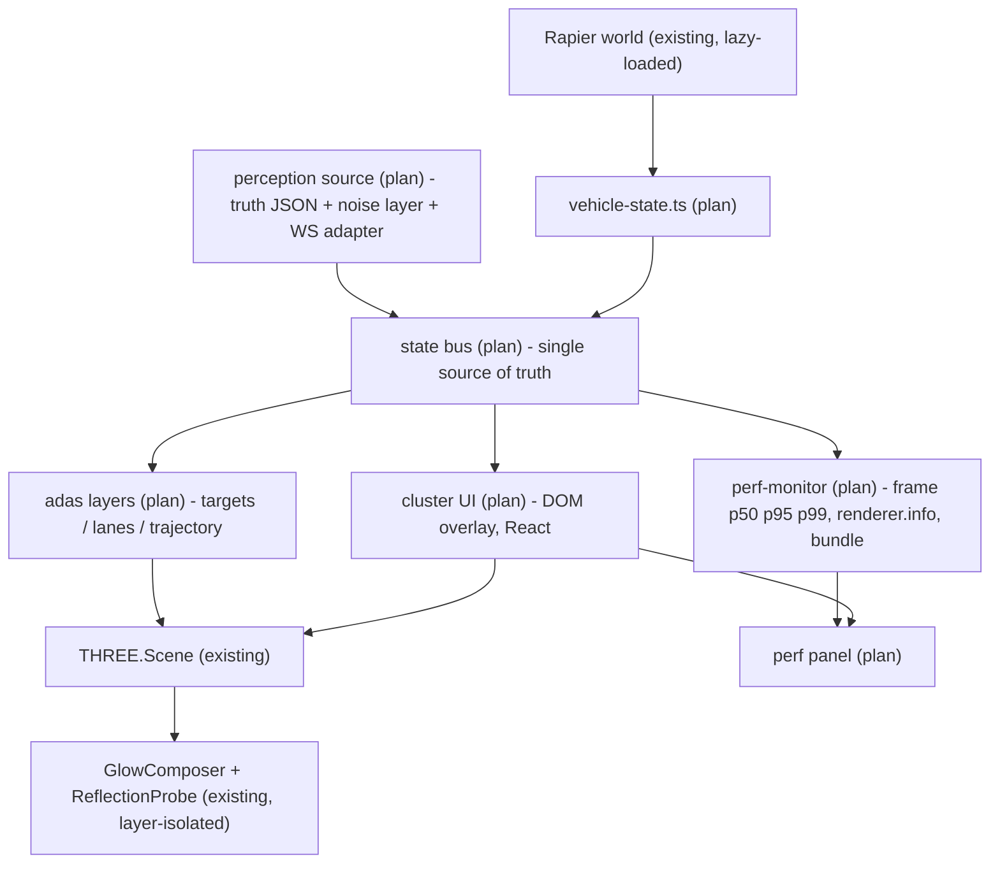
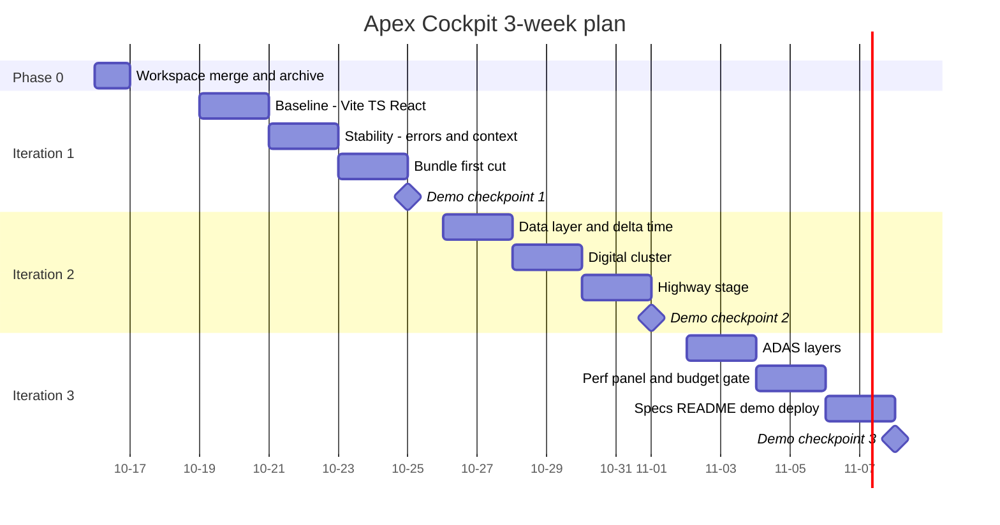

# Apex Cockpit 迭代规划 v1

> 目标：把 `apex-cockpit`（上游 `manuelhintermayr/three-js-car-example`，MIT）二次开发为**面向"座舱工程师（3D 可视化）"岗位**的作品集项目。
> 周期：**3 周**（阶段 0 于 10-16 半天；迭代 1/2/3 分别对应 10-19 起的三周），投递窗口从 **2026-11-09** 起。
> 本文件只做规划，**尚未改动任何源码**；`docs/` 之外无新增文件。
> 证据口径延续 Phase 1 报告：[代码库分析报告](./2026-10-15-codebase-analysis.md)。【已有】= 源码/实测可验证；【推断】= 有依据的估算；【计划】= 待新增。

---

## 0. 已锁定决策

| ID | 决策 | 取值 | 依据 |
|---|---|---|---|
| A1 | 目标岗位 | **智驾可视化为主 + 数字仪表为辅**，渲染深度作加分 | 岗位实际职责（HMI + 智驾可视化双主线） |
| A2 | 时间预算 | **3 周 / 3 个迭代**，每周收尾都可演示 | Phase 1 工作量估算 ≈9–10 有效天 + 50% buffer |
| A3 | 评估方式 | 按**现场跑 demo + 讲代码**设计 | P0 健壮性问题成为硬门槛 |
| A4 | 场景策略 | 迭代 1–2 **不动** `world.js`；迭代 2 起并行新增高速舞台 | 保证任何时刻可演示 |
| A5 | 文档语言 | **中文为主 + 保留英文**，代码注释英文 | 覆盖国内/海外面试官 |
| Q6 | 唯一工作区 | **`apex-cockpit`**；旧副本归档不删 | 两份逐字节相同且 remote 都指向上游 |
| Q7 | 交付形态 | 独立静态部署 + Resume 站项目卡片（可选懒加载 iframe） | 面试官"点开就能玩" |
| Q8 | 技术栈 | **Vite + TypeScript + React 19**（JD 硬要求 TS；框架与简历主栈一致） | JD 第 2 条；简历 40 万行 React+TS |
| Q9 | 物理与包体 | **保留 Rapier 但懒加载**；高速舞台自车走确定性轨迹 | Rapier 占首屏 64%（实测 2.86 MB） |
| Q10 | 感知数据源 | **真值 JSON + 噪声化感知层**双层，预留 WebSocket 适配器 | 让"感知不确定性"成为可展示叙事 |
| Q11 | Trellis 迁移 | 提交 `.trellis` + `.agents` + `.dsh` + `.cursor` + `AGENTS.md` + `.gitattributes`；`.trae/.codebuddy/.codex` 进 `.gitignore` | 作品集第一印象 |
| Q12 | 发布通道 | **迭代 3 决策**；迭代 1–2 只保证"本地可演示 + 产物 host-agnostic" | 本机 GitHub 不可达（实测 000） |
| Q13 | 叙事权重 | **性能工程 ≈ 稳定性与适配 > 智驾语义 > 3D 渲染深度 > HMI 交互** | JD 把性能与稳定性写成独立职责 |
| Q14 | 设备基线 | 本机 Chrome + DevTools 节流为主；真机（安卓平板）为加分 | 无真机也可完成车机适配工程 |

> 任何一条都可推翻，改动成本 = 对应章节重排；但**Q8/Q9 是其他所有计划的锚点**，若改这两条需要重算第 4–8 节。

---

## 1. JD 对齐矩阵（规划的骨架）

| JD 原文要点 | 现状证据 | 对应工作流 | 可量化验收 |
|---|---|---|---|
| 基于 **TypeScript** + Three.js/WebGL 搭建场景、渲染、调优 | 纯 JS，无构建、无类型 | W1 工程基线 | `tsc --noEmit` 通过（strict）；`game/` 全部 `.ts` |
| **帧率、内存、加载速度、包体、耗电、算力**优化 | 首屏 **4.48 MB raw / 1.44 MB gzip**；每帧 4 次全场景遍历；DPR 硬编码 1 | W2 性能与包体 | 首屏 ≤ **450 KB gzip**；draw call ≤ **80/帧**；总包 ≤ **0.9 MB gzip** |
| **车机、平板适配、卡顿、闪退** | **零** `webglcontextlost` 处理；异常即永久停帧；4 处监听器泄漏 | W3 稳定性 | 上下文丢失后 ≤ **60 s** 自动恢复；注入异常不冻屏；低端模拟下 ≥ **30 fps** |
| 维护现有代码、修线上 bug、提升稳定性 | 两处缓存 Promise 反模式；无错误 UI；0 测试 | W3 + W1 | 首批 **≥12** 个单测；启动失败有可见错误态与重试 |
| **技术规范制定、工具开发、技术沉淀** | `.trellis/spec/frontend/*` 6 个文件全是 `To fill` | W6 沉淀 | 6 个 spec 填实；自研 perf 面板；中英 README |
| 座舱 HMI / 智驾可视化 3D 表达、UI、动画、交互 | DOM overlay + 20 Hz HUD；无 ADAS 图层 | W4 仪表 + W5 图层 | 仪表 20 Hz 无掉帧；目标框 60 个仍达标；真值/感知可切换 |
| 与产品/车端/算法团队联调 | 数据只有一条通向 Vue 的路 | W4 数据层 | 状态总线单向数据流；数据源可插拔（JSON/WS） |

---

## 2. 目标架构

改造前 → 改造后的关键结构差异：

| 关注点 | 改造前【已有】 | 改造后【计划】 |
|---|---|---|
| 构建 | import map + CDN，零构建 | Vite + TS，产物为静态 `dist/` |
| UI 框架 | Vue 3 全局**dev** 构建（601 KB） | React 19 + TS，按需打包 |
| 状态 | 唯一去处是 `vueApp.data()`，Three 侧无处消费 | 状态总线：Three 与 UI 同等订阅；`vueApp` 直写被替换 |
| 时间步 | 仅物理吃 delta | 控制/相机/座舱插值全部 delta 化 |
| 异常 | 循环永久停帧，无 UI | 错误边界 + 恢复入口 + 上下文丢失重建 + 质量降级 |
| ADAS | 无 | 独立 Layers 图层，与辉光/反射探针隔离 |
| 可观测性 | 无 | `renderer.info` + 帧时间分位 + bundle 预算门禁 |
| 规范 | 6 个空 spec | 按真实代码回填的 spec + CI 脚本 |

---

## 3. 阶段总览

| 阶段 | 工作日 | 一句话产出 | 对应工作流 |
|---|---|---|---|
| 阶段 0 | 0.5 | 唯一工作区 + Trellis 工具链就位 | W0 |
| 迭代 1 | 5 | **能被可靠运行的 TS 工程**：类型、错误边界、上下文恢复、包体首刀 | W1 W2 W3 |
| 迭代 2 | 5 | **有数据的座舱**：状态总线 + 数字仪表 + 高速舞台 + 帧率无关 | W4 |
| 迭代 3 | 5 | **有叙事的智驾可视化**：图层、噪声感知、性能面板、规范与交付 | W5 W6 |

---

## 4. 阶段 0：工作区整合（10-16，0.5 天）

**目标**：消除双副本分叉，把 Trellis 工作流搬进唯一工作区。

| 动作 | 具体内容 | 体量 |
|---|---|---|
| 迁入工具链 | `.trellis/`（丢空任务 `tasks/00-bootstrap-guidelines`）、`.agents/skills/`、`.dsh/`、`.cursor/`、`AGENTS.md`、`.gitattributes`、`.trellis/workspace/HelongZhou/journal-1.md` | ~160 文件 |
| 补 `.gitignore` | 追加 `node_modules/`、`dist/`、`.trae/`、`.codebuddy/`、`.codex/` | — |
| 归档旧副本 | `three-js-car-example` 移出 `newcode/`（改名为 `ARCHIVED-three-js-car-example` 或移到 `~/Documents/archive/`），**不删除** | — |
| 远程与命名 | `git remote` 暂不指向新仓库（GitHub 不可达）；目录名保持 `apex-cockpit` | — |

**验收**：`apex-cockpit` 是唯一含源码的副本；`git status` 干净（仅有意提交）；Trellis 的 `workflow.md`/`spec/`/`scripts/` 可读；旧副本仍可 `python3 -m http.server` 跑起来作为回归参照。

**风险**：`.trellis/scripts/*` 依赖 Python 3（本机 3.13.12 已具备）；旧副本的 `.trellis/.version` 与新平台无冲突（未重跑 `trellis init`）。

---

## 5. 迭代 1（10-19 → 10-25）：工程基线与稳定性

**目标**：让它"**能被稳定运行**"，并满足 JD 的 TypeScript 与稳定性要求。这一轮不新增业务功能，只换地基。

### 5.1 交付物与改动清单【计划】

| 类型 | 文件 | 说明 |
|---|---|---|
| 新增 | `package.json`（替换为含 deps 的版本）、`vite.config.ts`、`tsconfig.json`、`src/` 目录 | Vite + TS + React 19 |
| 改造 | `index.html` → 去掉 import map 与 CDN script，改为 `
` + `<script type="module" src="/src/main.tsx">` | 首屏不再加载 Vue dev 构建 |
| 迁移 | `game/*.js`（13 个）→ `game/*.ts` | **只加类型，不重写逻辑**，保持函数名与行为不变 |
| 重写 | `vue-app.js` + `components/*.js`（672 行）→ `src/ui/*.tsx` | 4 个组件 + store；CSS 539 行原样复用 |
| 新增 | `src/core/render-loop.ts` | 渲染循环包 try/catch + 计数 + 恢复入口（替代直接 `setAnimationLoop(renderFrame)`） |
| 新增 | `src/core/context-loss.ts` | `webglcontextlost` / `webglcontextrestored` → 阻止默认、停循环、重建 renderer/composer/探针/纹理、恢复 |
| 新增 | `src/core/loading.ts` | 启动态机 + 可见错误 UI + `重试` 按钮（替换"只 console.error"） |
| 修改 | `game/physics-world.ts`、`game/car-model.ts` | 修掉"失败也被永久缓存"的 Promise 反模式，支持重试 |
| 修改 | `game/three-game.ts` | Rapier **懒加载**（首帧后再装，含加载态）；接入错误边界与上下文恢复 |
| 修改 | `game/telemetry.ts` | 写入状态总线，不再直写 `vueApp` |
| 新增 | `tests/*.test.ts`、`scripts/check-bundle.mjs` | vitest 纯函数测试 + bundle 预算断言 |
| 回填 | `.trellis/spec/frontend/{directory-structure,type-safety,state-management,quality-guidelines}.md` | 按**实际迁移后的代码**写，不写空想规范 |

### 5.2 包体首刀（JD 第 4 条的硬指标）

| 载荷 | 现状【已有/实测】 | 手段 | 目标【推断】 |
|---|---|---|---|
| Rapier `+esm` | 2,855,554 B raw / 1,083,388 B gzip（base64 内联 1.97 MB wasm） | ① 自托管 `.wasm`（二进制，省掉 base64 的 33% 膨胀）② 首帧后懒加载 ③ brotli 传输 | 首屏 **0**；二次载荷 ≈ 1.97 MB raw / **≈ 600–700 KB gzip** |
| Vue 3 **dev** 构建 | 601,662 B raw / 134,032 B gzip | 换 React 19 生产构建 | **≈ 45–60 KB gzip** |
| three 全量 | 650,153 B raw / 128,932 B gzip | tree-shaking + 仅导入所用 addons | **≈ 120–130 KB gzip** |
| Draco 解码器 | 285,747 B wasm | 评估离线烘焙 GLB（用体积换掉解码器与 CDN 依赖） | 迭代 3 按实测决定 |
| 业务 + CSS + GLB | ≈ 150 KB | 常规压缩 | ≈ 140 KB gzip |
| **首屏合计** | **≈ 1.44 MB gzip** | | **≤ 450 KB gzip** |
| 总合计（含 Rapier） | ≈ 1.44 MB gzip | | **≤ 0.9 MB gzip** |

**验收**：`npm run build` 后 `scripts/check-bundle.mjs` 断言首屏 ≤ 450 KB gzip 且总包 ≤ 0.9 MB gzip；`dist/` 为纯静态产物，`python3 -m http.server` 直接可跑。

### 5.3 稳定性验收矩阵

| 场景 | 现状 | 迭代 1 后验收 |
|---|---|---|
| 渲染循环内抛异常 | 永久停帧（three `WebGLAnimation` 语义） | 捕获 → 停循环 → 显示错误面板 → 一键恢复；日志带上下文 |
| `webglcontextlost` | 无任何处理 | 事件被捕获；`restored` 后重建 GPU 资源并续帧；≤ 60 s 内回到可交互 |
| 启动期 CDN/解码失败 | 永久失败，仅 console | 可见错误 + 重试；失败不污染后续重试 |
| 页面隐藏/切后台再回来 | 未处理（物理用模拟秒，视觉会跳） | 回到前台首帧 delta 归零，无跳变 |
| 低端设备 | 无降级 | 质量档（关反射探针 / 关辉光 / 关阴影 / DPR 上限）可手动与自动切换 |
| 监听器泄漏 | 4 处未移除 | `dispose` 全覆盖；用计数器断言"注册数 == 注销数" |

### 5.4 回归基线（迁移不能悄悄改行为）

用 5 条操作链做逐链验收（键盘起步/转向/跳跃/重置/C 键与移动端视角、触摸摇杆）：**迁移前后录制同一段操作序列，逐帧比对车速/位置/朝向曲线**；`game/` 层因"只加类型"应产出**逐位一致**的物理结果。

**验收**：`npm run typecheck` 通过（strict）、`npm run test` ≥ 12 用例通过、5 条链行为一致、首屏与包体达标、`dist/` 静态可跑。

**风险**：① 一次迁完 UI 与构建，回归面大 → 用上述逐链比对 + 每轮打 tag；② React 重写引入状态管理差异 → 状态总线在迭代 1 就定型，避免二次搬家。

---

## 6. 迭代 2（10-26 → 11-01）：数据层、数字仪表、高速舞台

**目标**：让数据"**有地方去、有地方来**"，并长出第一块 HMI（仪表）与第二个舞台（高速）。

### 6.1 交付物与改动清单【计划】

| 类型 | 文件 | 说明 |
|---|---|---|
| 新增 | `game/vehicle-state.ts` | 纯计算：车速（m/s + km/h）、纵/横加速度、横摆角速度、四轮转速、转向角、挡位、碰撞事件；**不依赖 Three/Vue**，可单测 |
| 新增 | `game/state-bus.ts` | 单一数据源 + 订阅；Three 侧与 UI 侧同等消费 |
| 修改 | `game/controls.ts`、`game/follow-camera.ts`、`game/car.ts` | 全部 **delta 化**（修 Phase 1 的 F1–F4） |
| 修改 | `game/telemetry.ts` | 判定逻辑保留，输出改为"事件 + 快照"发布 |
| 修改 | `game/physics-world.ts` | `UNITS_PER_METER` 真正用于单位换算（修 U1/U2） |
| 新增 | `game/scenes/highway.ts` | 高速公路舞台：kinematic 自车沿可复现轨迹巡航，环境物用 Rapier |
| 修改 | `game/game-session.ts` | 接受 scene 工厂，支持影棚/高速切换 |
| 新增 | `src/ui/cluster/{SpeedGauge,GearIndicator,PowerBar,AdasStatusIcons}.tsx`、`css/cluster.css`、`src/ui/scene-switcher.tsx` | 数字仪表（DOM overlay，复用现有 `z-index: 1000` 层级约定） |
| 新增 | `tests/vehicle-state.test.ts`、`tests/unit-conversion.test.ts` | 单位换算与信号正确性 |

### 6.2 验收标准

| 项 | 验收 |
|---|---|
| 帧率无关 | 同一操作序列在 **30 / 60 / 144 Hz** 下，车速-时间曲线与相机跟随误差在容差内一致（给出对比表） |
| 单位正确 | HUD 显示值 = 物理速度 × (1/`UNITS_PER_METER`) × 3.6，误差 0；"Top Speed" 与理论值对得上 |
| 仪表 | 20 Hz 刷新无掉帧（帧时间 p95 不因仪表上升超过 0.5 ms）；挡位/告警状态由数据驱动，非硬编码 |
| 舞台切换 | 影棚 ⇄ 高速 切换 ≤ 200 ms，无资源泄漏（切换 20 次后内存与 draw call 回到基线） |
| 数据可插拔 | 状态源接口化：JSON 回放与"实时模拟器"可互换，UI 不改 |
| 测试 | 单测 ≥ 25 用例；`vehicle-state` 覆盖率 ≥ 80%（纯函数易达标） |

**风险**：① kinematic 自车与 Rapier 环境的交互边界（碰撞/超车）需明确"只做可视化不求解"；② 仪表若用 canvas 绘制会与 3D 抢主线程 → 本方案坚持 DOM/CSS + transform，避免额外渲染上下文。

---

## 7. 迭代 3（11-02 → 11-08）：ADAS 可视化、性能工具、沉淀与交付

**目标**：补齐 JD 的"智驾可视化"与"规范/工具/沉淀"，并把项目变成可投递状态。

### 7.1 交付物与改动清单【计划】

| 类型 | 文件 | 说明 |
|---|---|---|
| 新增 | `game/adas/targets.ts` | 目标框（对象池 + 速度矢量 + 类别标签），支持真值/感知两套数据 |
| 新增 | `game/adas/lanes.ts` | 车道线（`CatmullRomCurve3` + 参数化宽度；可复用于横向误差计算） |
| 新增 | `game/adas/trajectory.ts` | 规划轨迹 + 预测时域着色（TTC/风险色带） |
| 新增 | `game/adas/perception-noise.ts` | 把真值"降级"为感知输出（漏检、框抖动、航向误差），支撑"真值 vs 感知"切换叙事 |
| 新增 | `game/adas/layers.ts` | 独立 `THREE.Layers` 分配；**反射探针与辉光 pass 排除 ADAS 图层** |
| 修改 | `game/rendering.ts` | ① 辉光 pass 改为按 layer 过滤（省掉"全场景换黑材质"那次遍历）② 阴影贴图节流 ③ 反射探针空闲暂停 ④ 质量档实现 |
| 修改 | `game/world.ts` | 塔/墙用 `InstancedMesh` |
| 新增 | `game/perf-monitor.ts` + `src/ui/perf-panel/*.tsx` | 帧时间 p50/p95/p99、`renderer.info`（calls/triangles/textures/geometries）、物理步数、包体基线；`F12`/`` ` `` 切换（复用现有快捷键约定） |
| 新增 | `tests/adas/*.test.ts` | 车道拟合、噪声模型、对象池边界 |
| 回填 | `.trellis/spec/frontend/{component-guidelines,hook-guidelines}.md` | UI 成型后按真实写法回填 |
| 交付 | `README.md`（英文）+ `README.zh.md`、`docs/demo/*`（GIF/截图）、`dist/` 部署 | 中英双份 + 演示资产 |

### 7.2 性能预算表（迭代 3 收尾时的对外数字）

| 指标 | 现状【已有/推断】 | 目标 | 测量方式 |
|---|---|---|---|
| 首屏 gzip | ≈ 1.44 MB | **≤ 450 KB** | `scripts/check-bundle.mjs`（构建产物） |
| 总包 gzip | ≈ 1.44 MB | **≤ 0.9 MB** | 同上 |
| draw call / 帧 | ≈ 120–150【推断】 | **≤ 80** | perf 面板 + `renderer.info.render.calls` |
| 场景遍历 / 帧 | 4 次 | **≤ 3 次**（阴影节流 + 探针暂停） | 代码路径 + 面板 |
| 帧时间 p95（本机） | 待测 | **≤ 16.7 ms**（60 fps 目标） | perf 面板 |
| 帧率（CPU 4× 节流） | 待测 | **≥ 30 fps**（车机代理基线） | DevTools + 面板 |
| ADAS 负载 | — | 60 目标 + 3 轨迹仍达标 | 压力场景脚本 |
| 内存（切换 20 次后） | 未测 | 回到基线 ±5% | `performance.memory` + 资源计数 |

### 7.3 沉淀与交付验收

| 项 | 验收 |
|---|---|
| 规范 | 6 个 `spec/frontend/*.md` 全部填实，且**每条规范都能指向仓库里的真实代码** |
| 工具 | perf 面板可现场演示"优化前/后"对比；bundle 预算脚本可在 CI 或本地一键跑 |
| 文档 | 中英 README：项目定位、架构图、性能数据表、如何在 5 分钟内本地跑起来、与上游/第三方的关系与署名 |
| 演示 | 一段 ≤ 60 s 的录屏（影棚驾驶 → 高速巡航 → 真值/感知切换 → 性能面板） |
| 通道 | 落实 Q12：探明可达通道（代理推 GitHub / Gitee / 其他），完成一次真实发布；`dist/` 静态产物就位 |
| Resume 站 | 项目卡片（封面 + 一句话 + 链接），可选懒加载 iframe |

**风险与回退**：① 时间不足 → 砍 `trajectory.ts`（保留目标框 + 车道线），它是最不影响 JD 对齐度的一项；② 图层隔离若影响画面观感 → 优先保"ADAS 不进车体反射"这一条；③ 发布通道仍不可达 → 交付形态退化为"本地静态 + 录屏 + README"，并在简历中说明可现场演示。

---

## 8. 质量门禁（三周内始终生效）

| 门禁 | 命令 | 何时跑 |
|---|---|---|
| 类型 | `npm run typecheck`（`tsc --noEmit`，strict） | 每次提交 |
| 单测 | `npm run test`（vitest） | 每次提交 |
| 构建 | `npm run build` | 每次提交 |
| 包体预算 | `node scripts/check-bundle.mjs` | 每次构建后 |
| 行为回归 | 5 条操作链脚本化对比（迭代 1）/ 三档帧率对比（迭代 2） | 每个迭代收尾 |
| 稳定性 | 异常注入 + 上下文丢失 + 低端节流 三件套 | 迭代 1 与迭代 3 |

---

## 9. Trellis 任务映射

| 本规划 | Trellis 落法 |
|---|---|
| 阶段 0 | 一个 bootstrap 任务（工作区整合），`prd.md` 直接引用本文第 4 节 |
| 迭代 1/2/3 | 各一个 **parent task**，其下 3–5 个 child task（如迭代 1：迁移 / 稳定性 / 包体 / 规范） |
| 每轮任务上下文 | `implement.jsonl` 从填充后的 `.trellis/spec/frontend/*` 与本文对应章节取条目（满足"manifest 不得为空"的校验） |
| 收尾 | 每轮用 `trellis-finish-work` 归档任务并把结论写进 `.trellis/workspace/HelongZhou/journal-*.md` |

---

## 10. 不做清单（明确的 out of scope）

真实感知算法/点云管线、后端与云端、Unity/Godot/Cocos 移植、多屏物理联动与语音交互、完整设计系统（Design Token + 组件库）、上线运维与灰度发布、车规认证相关内容。

理由：这些无法在三周内做出可信深度，且不是 JD 的核心考核点；把时间投在"性能/稳定性/可视化叙事"上回报率更高（对应 Q13 的权重）。

---

## 11. 每轮结束时的面试可讲点

| 时点 | 你可以讲什么（都带真实数字） | 命中的 JD 条目 |
|---|---|---|
| 迭代 1 后 | "我把首屏从 1.44 MB gzip 压到 X，并补上了 WebGL 上下文丢失恢复与渲染循环错误边界 —— 之前任何一个异常都会让画面永久冻结。" | 包体/加载速度、闪退、稳定性、维护现有代码 |
| 迭代 2 后 | "我把一个隐含 60 fps 假设的 demo 改成帧率无关：控制、相机、座舱动画全部 delta 化，并抽出车辆状态层，让 3D、仪表、日志消费同一份真实物理数据。" | 帧率优化、HMI 模块开发与迭代、联调对接 |
| 迭代 3 后 | "我做了带噪声的感知可视化（真值 vs 感知可切换）、把 draw call 从 ~140 降到 X，并写了自研性能面板与包体预算门禁；同时把 6 份前端规范按真实代码回填。" | 性能优化、工具开发、技术规范制定与技术沉淀 |

---

## 12. 下一步

**默认动作**：按第 4 节执行**阶段 0（工作区整合）**，然后进入迭代 1。

需要你一句话确认即可开工；阶段 0 的动作包含**移动/归档会话工作区之外的文件**（`~/Documents/newcode/three-js-car-example`），会触发一次沙箱授权，我会在执行前把确切路径列出来。

*规划文档 v1 · 未改动任何源码 · 决策如第 0 节所示，可随时推翻*
